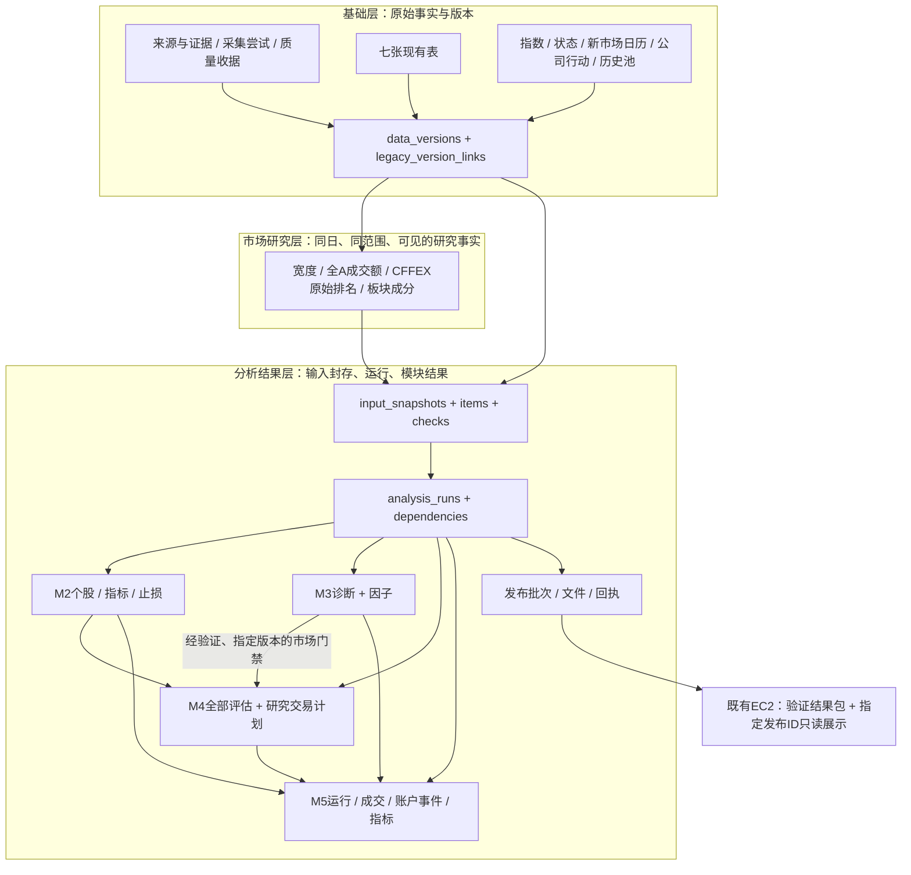
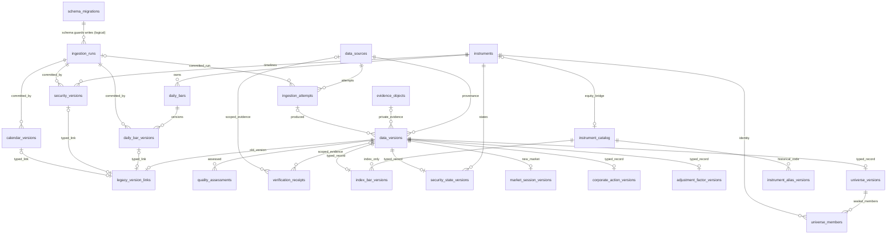
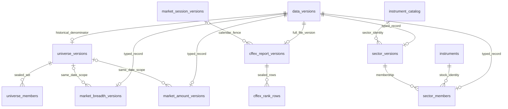
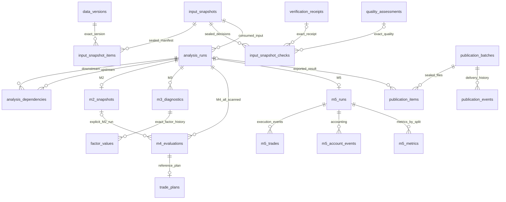

# 三层逻辑模型与跨层关系

所有新节点均为PROPOSED，现有七表保持物理身份/SQL/checksum。完整字段、键及示意见[字典](DATA_DICTIONARY.md)，事实/证据分类见[总设计](DATA_PERSISTENCE_ARCHITECTURE.md)。箭头是依赖，不表示已经接线。

## 1. 三层总览

指数原始OHLC属于基础事实，指数趋势/恐贪的raw、normalized、weight、contribution属于分析派生；“市场研究层”负责范围与原始聚合事实，不再复制一套核心指标算法。波浪/CFFEX净仓等派生解释仍由现有M3核心输出，证据缺失保持BLOCKED。

## 2. 基础层ER

ER中的`schema_migrations→ingestion_runs`只表示生命周期保护，**没有物理FK**。其余图中“可选typed_link”由B05恰一非NULL约束收紧，不能同时链接三种版本。所有typed版本行主键FK→data_versions，未为每条重复画边；自修订链见字典。目录是可追溯桥，不替代旧事实、三个Repository或现有整数主键。

证券历史：E06名称/生命期继续复用；B09补ST/停牌/买卖限制/交易单位/限价事实。B08登记指数/行业/期货独立命名空间。B16不构成现有DailyBar改代码写入支持；此类业务转换仍阻断，禁止制造另一个上市身份掩盖缺口。

## 3. 市场研究层ER

宽度分母是B14/B15逐日历史池，日历分母是独立、可见的会话查询，两者不同；不得用返回报价日期代替应有交易日数，也不得用上涨+下跌+平盘冒充全部可统计股票。不同源同日宽度/成交额可加入同一快照的前提是**口径/范围/业务日一致，且各自版本均在共同as_of可见**；不是只按日期字符串join。

CFFEX正式版本单位是整份品种/日文件，子行按合约/会员口径/方向区分；缺一侧不置0，不跨月拼“机构净持仓”。source published_at与实际观察/入库、最早可执行会话分别保存，权威日历未知不生成正式可消费record。

## 4. 分析结果与发布ER

input_snapshots的content ID与核心Diagnostic.data_snapshot_id是**两个不同命名空间**：前者固定实际数据库/文件版本全集，后者是现有核心对request/source/times/coverage/values/规则的摘要。两者分别保存并验证对应关系；不修改核心hash算法，不把看似同名的hash替换。

## 5. 六条端到端路径

1. **M0股票事实**：明确请求→attempt及私有EvidenceStore证据→现有write_many单事务写run/instrument/bar/version→新增目录链接（未来在同事务或明确补目录任务中）→快照item引用精确version/hash。观察时间缺失保持NULL；若原事务成功而证据完成失败，保留原写结果与质量/证据失败，不宣称“整个网络+文件+SQL天然一个事务”。
2. **市场研究输入**：指数typed版本、同日历史池、宽度、成交额、日历及状态均单独带来源/时点→SnapshotRepository按同一cutoff与固定选择政策封存；未认证源可以登记观察，但COMPLETE结构状态不等于正式研究准入。
3. **M3结果**：封存输入→固定SHA/规则的现有core→八项完整Diagnostic及因子历史→一份analysis_run与各模块snapshot映射原子保存。读取只还原已保存结果，不偷偷重算；重放另起run并记录replay_of。
4. **M4门禁**：显式读取M2 run及指定M3 environment/strategy_admission，验证输入/代码/规则/review/time/scope→现有M4 evaluate计算→保存所有评估和双止损计划。缺M3/未获准时仍可保存单股研究结果，但eligible=false、entry_allowed=false，不升级L1或用固定市场评分。
5. **M5回放**：先封存完整候选输入全集，再对每个虚拟会话选择当时可见版本，不把一个期末snapshot整体提供给全部历史会话。账户事件/订单/成交/价格引用分开、按序可重算；缺会话或可交易性证据阻断，不能以成交缺失填0收益。研究重算时间与虚拟signal_at分开，详见血缘文件。
6. **EC2展示**：本地run→批准的脱敏静态结果文件与manifest→私有传输→接收校验→原子激活publication_id→页面显示指定ID。代码SHA、生产者SHA、接收端SHA和结果包ID各自保留；无数据库迁移/全量SQLite传输的前提下即可实现只读展示。

这些都是待实现的消费契约，不能把图中M3→M4或Publisher→EC2箭头当作现有可运行链路。
