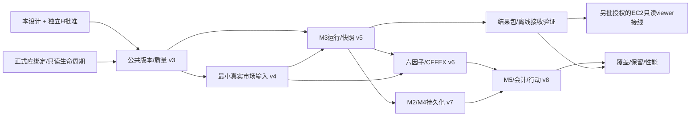

# M0—M5持久化矩阵、来源状态与实施路线

基线main `c4b682d12c7c8dc42f75e717b855238f635ce05b`，证据分类F/E/P/U见[总设计](DATA_PERSISTENCE_ARCHITECTURE.md)。F描述源码路径，E为固定旧验收，不是本轮开库/请求。所有拟议仓储/表均P。

## 1. 当前模块与真实出口

| 模块 | 现有生产者/写入 | 现有读取/消费者 | 持久化结论与缺口 |
| --- | --- | --- | --- |
| M0 | DailyHistoryIngestor.collect→EvidenceStore request/response/result；SQLiteMarketDataRepository.write_many；独立SecurityMaster/TradingCalendar.write_many | get_bar/get/resolve/get_day/trading_days | 股票事实及参考端口真实实现；失败采集/质量/来源登记缺正式SQL模型；health ScratchWriter写临时库，不是正式库 |
| M1 | 显式按钮可采集；共享入口initialize | demo_data.read_bars→严格get_bar；UI图/表共用frame | 读取已保存股票，无M1结果仓储需求；AI_TRADE_READ_ONLY只关采集，不保证零写初始化 |
| M2 | analyze纯计算；显式采集沿M0 | analysis_page从SQLite读行情；summary/frame/risk供页面，session状态保留 | 无单股分析/评分/止损正式结果持久化；已有规则m2-research-v1不重写 |
| M3输入 | collect_public/collect_cffex→save_snapshot写内容寻址m3-observations JSON | 页面catalogue/from_snapshots；股票支路read_bars | 指数/宽度/CSV可保存观察文件；不是SQL研究模型/正式排名仓储；read root决定实际可见文件 |
| M3结果 | 页面Diagnostic仅内存；显式verify_m3_pipeline.run保存完整pipeline-bundle.json与summary.json | 页面不读此bundle；脱敏download删values | 有脚本结果文件出口，无正式运行/快照Repository和历史查询；下载/哈希不能当完整保存 |
| M4 | load_batch/analyze/evaluate；cache_data/session_state | 自己的CandidateBatch；SQLite价与master.resolve | 无正式候选/计划持久化；未消费M3 snapshot，默认MarketState阻断；最多20股420日，不是全A池 |
| M5 | 无正式回测/订单/账户引擎或页 | 无 | 未实现，项目进度页不是回测；本设计只有待实现账本/指标模型 |
| EC2 | 代码Git archive/release/current；独立DATA_DIR | 现有应用查询云端本地库/文件 | 没有PC结果自动发布/同步；旧部署证明当时空库，不证明当前状态，本轮不连AWS |

七表真实消费者细分：账本由共享启动使用；instruments/daily_bars/versions供M1/M2/M4及M3股票支路；ingestion_runs是写入与版本血缘；security_versions被M4 resolve消费，M3未接；calendar_versions独立端口存在，M3/M4未调用。表存在、代码引用、有写入口、已存真实行、被当前页面消费是五个不同断言，不能合并。

源码核对入口：`storage/schema.py` v1/v2；`data_access/repository.py:39,93`；`security_master/repository.py:46,67,77`；`trading_calendar/repository.py:48,51,66,95`；`market_data/ingestor.py:84`；`market_analysis_data.py:32,45,62,84`；`market_analysis_view.py:115,151,170,216`；`m3_data_pipeline.py:127,170`；`daily_candidates_data.py:15,33`；`demo_app.py:get_components`。上述行号属于固定main，正文相对链接供当前文件阅读；固定审计详细SQL/测试索引见PR46@b217546。

## 2. 市场研究来源、覆盖与许可矩阵

下表“频率”为源能力/期望更新，不是现有已启用调度；本轮行情发送次数0。HTTP成功、结构accepted、研究许可、历史可得和L2/L3分开。SDK许可不替代供应商存储/自动化/展示/再分发权利。

| 领域 | 实际来源/单位/频率 | E历史覆盖或传输证据 | 认证/许可/时间现状与待接通 |
| --- | --- | --- | --- |
| 个股日线 | Tencent/AKShare1.19.1 stock_zh_a_hist_tx；CNY/share、volume股、amount CNY；显式日线请求 | PR44/45的187/1217/2291条样本及#40两条；不是全A | 真实保存样本可追来源/批次；多数available/ingested在2026-10-18或20，不能回放为历史当天；observed列缺、身份/原始键/状态/许可未认证；源属于候选 |
| 东方财富日线 | stock_zh_a_hist，适配源手×100成股；日频 | #40限定600000两日请求SSL失败，HTTP/行数UNKNOWN | 当前连通U，不重复请求；失败不是空行情/休市；存储和许可未认证 |
| 指数历史 | 新浪stock_zh_index_daily，OHLC指数点；源历史响应，collector最多550条已结束日期；手动 | 三独立观察各550行，较新旧样本2024-07-10～2026-10-19 | event/available/认证日历/调整定义/质量/授权缺，部分格式ingested也缺；只能L1观察。volume/amount未知，不造全A金额；拟B11 |
| 指数趋势/波浪/周线 | 既有M3核心，派生单位方向/价格/比率；随显式run | 算法/测试存在，不等于真实完整历史 | 样本完整周、三右确认时点、源/日历/审核不足阻断；保存A06/A07，不另写算法 |
| 全A宽度 | 乐咕stock_market_activity_legu，仅当前5家数和统计日快照；家数；源更新频率保障U、手动 | #40 SSL失败，未取得真实聚合；未发现真实本地宽度历史 | 没有历史池/分区/分母/当日状态，五家数不等于全A完整范围；存储/自动化/展示许可U；拟R01+B14/B15 |
| 全A成交额 | UNKNOWN；必须真实全A CNY金额；期望日频 | 无已注册历史源/真实记录证据 | 不能以指数/个股额替代，范围/时间/贡献分母/许可全缺；拟R02 |
| 恐贪六因子 | 既有六因子规则：趋势25%、动量20%、低波动20%、上涨比20%、涨停比10%、全A额5%；原值+归一/分位+贡献 | 前三价格因子/独立代理代码可算；完整真实六输入不齐 | 六因子缺任一总分NULL，不重新分权重；前三因子代理除0.65且独立显示，不作完整情绪票。拟A07/A06，来源沿输入继承，非外部“恐贪实测源” |
| CFFEX排名 | CFFEX品种/日CSV，合约张数、方向/会员/代客或自营；源每日榜、具体发布时刻可能未知 | #40一个IF日样本SSL失败；现有parse/时点/版本链端口与合成测试 | 没有真实合格历史仓储/权威会话/发布时间/member_scope/授权认证。raw_csv不是正式CffexRankingsRecord；页面未传正式records；拟R03/R04 |
| SH/SZ/BJ日历 | SQLiteTradingCalendar端口；日状态，原E07可存 | 已知盘点613库参考行合计0，不扩大到全电脑 | 真实历史源/公告时间/许可未接通；不能用工作日或价格返回日期推断；原表复用 |
| CFFEX日历 | RankingCalendar仅port；开/收盘显式TS | 无真实认证数据 | 不复制SH日历，缺时点则榜单正式record构建阻断；拟B10 |
| 历史身份/名称/ST/停牌/交易限制 | master已有名称/生命期，ST与状态暂无源；每变动/日频视字段 | 已知重点库security_versions=0；instruments仅代码形式锚点 | 当前名称/缺bar/零成交不能补历史状态；原E06+B09，真实源/许可/频率保障U |
| 公司行动/复权 | 原v1仅factor_version字符串和口径约束；无行动/因子数据服务 | 没有已验收真实记录 | 公告发布时间、基准日、源、许可及行动关联待确认；拟B12/B13，不能用现有qfq标签当因子历史已齐 |
| 行业/板块/成分 | 尚无正式历史源/服务；体系/有效期口径U | 无已认证历史覆盖 | 热门/龙头/成长性不靠UI推算；行业分类拟R05/R06。财务成长另需披露/发布时间设计任务，不在本轮扩展完整基本面平台 |

本设计不选定新的行情供应商，不因候选URL已在代码里而声明数据许可。获准更新频率/请求上限、历史日期覆盖、有效分母、数据时间、展示范围必须分别验收，不按“接口能返回”整体PASS。

## 3. P0—P2实施路线（建议任务，不自动创建）

| ID / 优先级 | 范围与依赖 | 验收条件 | 风险/并行边界 |
| --- | --- | --- | --- |
| D0 / P0 | 正式库绝对路径/归属/备份批准；复用PR45，不重扫全部盘 | UI、M0采集、CLI同库身份与配置优先级明确；只读打开与迁移入口分离；未批准不初始化 | 生产/DB边界H；可与纯契约设计并行，物理实施前置 |
| D1 / P0 | 本设计独立H批准后实现公共来源/质量/版本目录v3；依赖D0 | 七表零重建、旧checksum不变；失败attempt/缺时点/收据撤销可追；复用Repository负例通过 | 迁移/真实性H；与来源授权资料核验并行，不与另一迁移者改同一registry |
| D2 / P0 | 指数与全A最小可验证输入v4；依赖D1和对应来源许可 | 少量明确日期/标的；真实指数/当日池/宽度/额/日历各有单位/版本/时点；缺项如实BLOCKED，禁止全A大回补 | 时间/分母H；可分来源适配并行，共享字段冻结，串行合并迁移 |
| D3 / P0 | M3 analysis_runs/snapshots持久化v5；依赖D1/D2契约、核心独立H状态披露 | 完整8模块to_dict+因子输入/输出保存，重开后按run还原，固定SHA和输入重放；未认证仍BLOCKED | 结果/未来函数H；可先用明确SYNTHETIC离线夹具开发，不冒充真实验收；核心review未通过不解准入 |
| D4 / P0 | 最小结果包/接收验证协议；依赖D1、D3输出schema | 离线构建/串改/缺项/权限失败/幂等/回执/旧包回滚通过；包不含DB/原始数据/秘密 | 安全H；传输validator可与D3并行实现固定schema；AWS接线需独立授权，不由本设计部署 |
| D5 / P1 | 恐贪六因子真实输入与CFFEX接线v6；依赖D2/D3、独立核心H/来源/日历/授权 | 同日六因子/完整历史分位可复现；缺因子不补，榜单单合约scope/time/缺侧测试；无真实L2证据继续BLOCKED | CFFEX与全A输入可并行采纳不同批准任务，不同时改同一核心策略/registry |
| D6 / P1 | M2结果与M4候选/风险持久化v7；依赖D3及获审M3适配 | 模式差异不变、0候选/失败股票保存、同run视图、双止损/1%/未知股数，M3旧日/冲突/缺审查拒绝 | 风险/准入H；可以与D5分开开发，不能未经正式M3 gate适配提前打开候选 |
| D7 / P2 | M5及公司行动/因子/别名v8；依赖D2/D5/D6和另行回测执行设计 | 每会话as_of、T+1/涨跌停/费用/现金/持仓/拒单、样本外分隔、全链重算；无真实输入不输出正式绩效 | 核心执行H，不能当普通表格任务；多策略比较共享同快照/成本 |
| D8 / P2 | 扩大覆盖/保留/性能；依赖D1–D7已验收的对应能力 | 基于实际批准小样本量测索引/时延/包尺寸；分区/列式读保同契约；删除前引用/授权/备份检查 | 迁移与删除H；无证据不引DuckDB/新平台，EC2压力测试另批范围 |

所有实现TASK固定一个执行模型/档位、独立分支和可验证验收，按G05/G12安排独立H；本表是依赖建议，不代表已建线程/Issue或批准采集/迁移。

D3逻辑实现可在D2真实源验收前用隔离合成夹具完成保存/重放测试，但真实数据端到端验收必须等待D2；这不是绕过依赖。D4可先交协议验证器，不能以离线通过宣称云端已展示。所有工作保持数据不足时可观察而不假定可交易。

## 4. 设计提交后的待确认项

正式库路径与容量/备份负责人；源存储/自动化/展示/再分发许可；真实CN_A/CFFEX日历与历史池；所有缺失event/available/observed/ingested证据；M3核心独立H；已审核收据签发信任根；M4顺序状态机/执行约束；M5撮合/会计/样本外规范；发布目标/字段隐私白名单与viewer协议。未知项阻断相应实施/准入，不阻断本次关系/字段/迁移设计交付。
