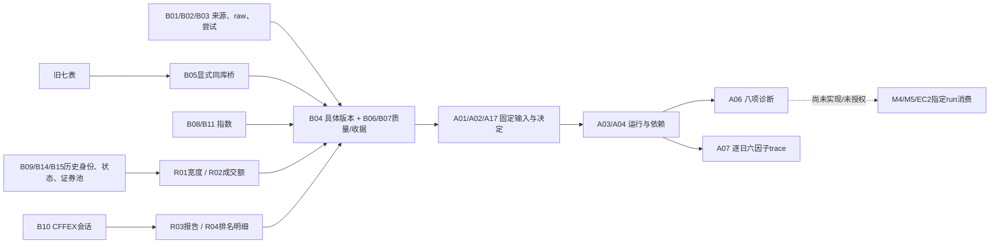

# TASK-M3-CORE-DATA-MODEL-001：实施检查点与阻断记录

**BLOCKED，非完成交付，不可合并/升级正式库。** 用户已明确批准Draft PR #51的24表、v3—v5最小方案。本记录保存批准后的实际代码与测试失败，不替代独立H审查。代码检查点为 `10c6f2cf6a33327d5e24d7b3880ef485052bb0ca`；最新main仍为 `04e530871e2c8b4889c60027ac8d1ec4275009a2`。执行模型固定 `gpt-6.1-sol / high`，无委派。

## 1. 停止原因与恢复条件

按 [AGENTS.md G10](../../AGENTS.md)：“同一验收项经两次有不同诊断依据的修复仍失败也须升级”。本轮CFFEX验收在两轮共享夹具修正后仍有空会员用例失败，保守按该限制停止相关修复、迁移/Repository和依赖开发。既有核心算法测试未出现已确认回归；失败不能被此前309/95项通过覆盖。

| 步骤/证据 | 实际结果 | 诊断和已采取动作 |
| --- | --- | --- |
| `existing-targeted-1.log` | 309 passed，exit0，21.74s | 原市场分析/核心、CFFEX、参考表、工作台相关测试；早于最终检查点，不冒充最终全套 |
| `storage-1.log` | 95 passed，exit0，6.47s | 新Schema/目录测试；早于最终检查点 |
| `market-1.log` | 24 failed，exit1 | 夹具旧证券来源缺adapter段；CFFEX的source_label按类方法调用，实际上是实例方法。修正夹具，没有放宽生产校验 |
| `market-2.log` | 20 passed / 4 failed，exit1，17.10s | CFFEX真实来源标签含run_id不允许的字符；修正共享批次夹具，用来源hash组成安全ID，source_id本身保留 |
| `market-results-3.log` | 35 passed / 7 failed，exit1，26.54s | named/混合/缺日历部分已到达存储测试；空会员夹具仍带数量，在既有解析器先被拒绝；另外6个结果测试的夹具向cffex_diagnostic传入不存在的contract参数 |
| `offline-blocked.log` / XML | **3028 passed / 7 failed / 1 skipped，exit1，307.76s** | 完整离线套件，绑定代码SHA `10c6f2c`；7项失败同上，真实AKShare集成用例按默认网络门禁跳过；新增6项因子trace旧行为/手算/前缀测试通过 |

失败输出定位：

- `tests/unit/test_m3_storage_market.py::test_unrepresentable_cffex_remains_evidence_and_blocked_attempt[blank]`，到 `src/ai_trade/market_data/cffex_rankings.py::_rows_for_side`：`RankingValidationError: numeric facts require an explicit member`。该用例尚未调用新save_cffex。源码允许空会员且数量/变化均为空的缺失行；不允许有数值无会员。
- `tests/unit/m3_storage_fixtures.py::compute` 向 `market_analysis_core.cffex_diagnostic` 传 `contract='IF2611'`；实际签名使用 `request.symbol`，没有contract参数。没有为使夹具通过而修改核心接口。
- 原始日志保留在工作区 `artifacts/m3-core-data-model-001/`；最终完整离线诊断结果和文件hash另见 `docs/evidence/TASK_M3_CORE_DATA_MODEL_001_IMPLEMENTATION.json`。日志中的数据均为离线SYNTHETIC，未请求供应商。

后续最小动作：独立H只读核查冻结SHA、上述夹具与接口、迁移/封存/时间/回放约束，确认失败归因和剩余风险；修复须按治理另立TASK，继承上述失败次数，不通过换编号重试。不能将修正夹具等同于证明结果持久化/重放已通过。当前实现会话不换角色自称独立H。

依赖检查 `python -m pip check`：exit0 / `No broken requirements found.`，本地Python 3.12.14；diff检查exit0。没有运行真实网络、UI端到端、样本外或EC2发布。仅文档证据提交不改变上述src/tests树，不重复宣称重跑。正式DB文件hash仍与阶段1相同。

原生 `git push origin codex/m3-core-data-model-001` 两次均因github.com:443连接失败而未上传，保留本地检查点；改用现有GitHub连接器交付相同Git内容树，禁止force更新。远端提交因连接器生成提交元数据而可能与本地SHA不同，PR正文必须同时列出本地测试SHA、远端冻结SHA及相同tree核验，不声称在未执行的远端SHA重跑。未修改代理/TLS/网络配置。

## 2. 实际文件与最小迁移集

| 迁移 | 当前新增定义 | 数量 | 验证边界 |
| --- | --- | ---: | --- |
| v3 provenance_and_version_catalog | B01—B08：data_sources/evidence_objects/ingestion_attempts/data_versions/legacy_version_links/quality_assessments/verification_receipts/instrument_catalog | 8 | 临时库安装、只读前缀、回滚/备份恢复有测试；正式库未执行 |
| v4 minimal_m3_market_inputs | B09/B10/B11/B14/B15、R01—R04 | 9 | 结构/部分输入测试；CFFEX空会员验收阻断 |
| v5 m3_analysis_persistence | A01/A02/A17/A03/A04/A06/A07 | 7 | 结构/快照部分测试；结果往返/重放测试未通过，不宣称可用 |

完整字段、NULL、主外键和字典索引沿用 [24表字段契约](M3_CORE_DATA_MODEL_DICTIONARY.md)，原39表字典未修改。DDL位于 `src/ai_trade/storage/m3_schema.py`，注册位于 `storage/schema.py::MIGRATIONS`；仍保留七张旧表。B12/B13/B16、R05/R06、A05/A08—A16共15表延期理由仍见阶段1方案。

v1 checksum仍为 `c6d31829bdef4ad9c6f45279c7696cfe94ac6acb9ff016c59320298b8e8dc0bd`；v2仍为 `a4a5c6b2bbf2008d1f452610ecc3213de3dc4fbfe62daa0f55c161e36ef88125`。没有修改其SQL。31表只在隔离测试库出现，不是正式库升级事实。

新增表均有拒绝UPDATE/DELETE触发器、RESTRICT外键和FK前导索引。复合对象使用deferred FK，子行先插入、父行最后封存；父存在后禁止追加子行。v4有序替换v3的typed-version封存触发器。SQLite约束负责结构，Repository负责跨行hash、来源和业务校验；直接改文件/删触发器、伪造可信调用方不在这些约束能认证的范围内。

## 3. Repository与调用边界

| 代码/接口 | 当前实现内容 | 未证明/未接入 |
| --- | --- | --- |
| `m3_store_values` | exact字段、UTC微秒、有限数值/int64、规范JSON/hash、NULL保留；不清洗非法输入为正常 | 未替代现有核心验证，也不验证供应商真实性 |
| `CatalogRepository` | source/instrument登记；私有root内hash证据；完成attempt；具体版本/hash读回、显式来源/as_of选择；旧版本显式同库链接；质量/收据历史链 | 无自动采集/旧库扫描/回填；无默认信任根 |
| `MarketInputRepository` | 指数与股票分表；证券状态/历史证券池；完整分母/质量/收据门禁的R01/R02；named CFFEX与原raw/calendar往返 | 没有可靠历史证券池/状态/授权时仍拒绝正式聚合；未运行真实来源验收 |
| `SnapshotRepository` | 精确版本+期望hash+固定质量/收据；来源绑定、时间/业务日检查、角色/ordinal/count/hash封存 | 不推断缺失分母；不自动选不明源；研究模式允许PARTIAL但不认证 |
| `M3ResultRepository` | 显式file-backed计算适配器；保存八项原Diagnostic.to_dict、strategy_admission、逐日六因子、构建/参数；失败run；显式run查询和同构建重放比较 | 新结果正向路径仍未通过；没有已审核生产计算适配器；没有页面/M4/M5/EC2调用 |
| `fear_greed_with_trace` | 复用原评分函数路径，增加raw ratio、normalized、固定权重和贡献；原公开fear_greed返回形状不变 | 新trace最终测试以完整日志为准；不能绕过核心ALL_A门禁直接把指数成交额作为市场因子 |
| `workbench.inspect_database` | 按实际安装的v2—v5连续账本验证精确DDL；未知表/缺触发器/checksum漂移仍拒绝 | 只读入口仍禁止initialize；不在刷新时迁移 |

批次请求JSON为 `m3-request-v1`，只允许symbol/start_date/end_date/variety/trade_date/kind/source_version/operation；失败attempt不伪造成功ingestion_run。验证/事务失败尽力独立记录FAILED；记录本身失败会显式报错，不能声称审计已保存。证据文件和SQLite不是跨文件原子事务：证据文件先create-only落盘，索引失败可能留下孤立文件；本轮不清理，后续须审核孤立证据登记方案。

质量评估只支持本地实际评估时点，不支持伪造历史assessed_at导入。B07需显式配置issuer/authority_ref/scope/用途信任根；无配置不能写VERIFIED/REVOKED。收据由受信编排传入，表与配置本身不完成身份认证。多个根决定冲突时拒绝挑PASS，重放冻结原决定而非偷偷换最新决定。

## 4. 时间、证据与JSON子契约

- B04内容身份含业务键、来源、版本、四时点、结构质量、证据/修订等，排除技术registered_at和attempt_id；载荷hash含规范typed行和有序子行。相同内容不重复建成功run。修订同业务/来源且时间推进，不分叉、不覆盖旧版。
- 旧daily_bar缺observed_at仍为NULL。B05链接原字段/hash且不改旧行；strict不能因此变可用。证券状态不知道ST/停牌/退市时不默认NORMAL。
- R03保存报告日期、published_at（未知保持NULL）、可用会话、B10版本及raw；B04另保存event/available/observed/ingested。原日历规则不改。R04保留contract/side/rank/raw member/scope/数量/单位语义；不称最终客户/国家队。
- 完整named且会员非空才写R03/R04；legacy/mixed/空会员必须保存raw和BLOCKED尝试。不重排rank0、补会员或丢行冒充完整。解析异常走失败尝试，非假成功。
- CFFEX完整日历血缘保存为B02 `m3-cffex-lineage-v1` manifest，通过B06固定lineage assessment关联报告。R03.scope_evidence_id保留真实scope语义，没有挪作日历清单。快照要求冻结全部calendar_versions和该lineage决定。
- R02本地求和使用 `m3-amount-inputs-v1`：每个具体daily_bar版本/hash一次、同日/未复权/CNY/完整证券池；旧bar缺observed会阻断。原生发布汇总使用 `m3-published-amount-v1`：source_id/source_version/market_key/trade_date/amount_cny/amount_unit/contributing_count/universe_version_id/raw_evidence_id完整匹配，明确区别于本地求和；raw映射真实性仍依赖独立来源审查，没有新采集器/自动认证。
- A01.scope_json使用 `m3-scope-v1`，包含market/symbols/required_roles/source_bindings；selection policy=`m3-explicit-inputs-v1`。A17冻结决定hash。未知/缺少/合成证据保留blocking reasons，strict/paper下阻断，research下可以PARTIAL供观察。
- A03.parameters_json为 `m3-analysis-parameters-v1`，明确config_version和values。environment_json为 `m3-build-v1`，记录实际HEAD、整个src Python树hash、dirty、计算适配器文件hash/名称、Python/SQLite/pandas/jsonschema版本。dirty构建不能SUCCESS；replay必须匹配构建/参数/快照/审核并比较稳定结果hash，不执行数据库中保存的代码。
- A06保留核心完整JSON与其自身diagnostic_snapshot_id；字典中的L1/L2/L3列值映射原枚举全名，不能改成新准入算法。策略调用原strategy_admission，live_trading恒false。A07每日期六行，raw_unit=ratio；缺失normalized/contribution为NULL，不填零/重分配。

上述是**当前代码和待审核的接口契约**，不等于正向路径均已验收。失败路径后续还需独立H检查，尤其构建身份、输入/收据关联、结果原值一致、回放和直接SQL绕过边界。

## 5. 三层关联与后续依赖

恢复策略：未来正式升级另批，先停止写入，使用已有SQLite backup API建立新备份并在隔离路径恢复验证，再显式执行有序迁移；失败整批回滚，成功后需要恢复也只用已验证备份，不能DROP新表伪装原地降级。测试在tmp_path执行，不运行正式升级命令。

后续依赖按顺序：独立H诊断本冻结SHA → 独立修复TASK和复核 → 隔离完整迁移/回放验收 → 真实来源及时间/许可小样本任务 → 另批正式升级/输入入库 → 页面指定snapshot/run接线 → 另批EC2发布与只读回读。七旧表不足以单独持久完整M3事实，当前正式库也没有这些新增事实。研究准入、生产发布与独立H均未因此获批。
