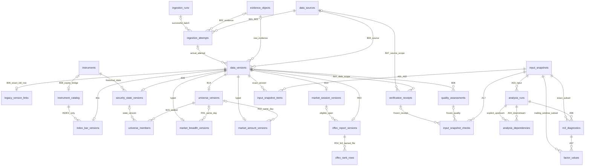

# TASK-M3-CORE-DATA-MODEL-001：现状核验与最小实施方案

状态：**本文件保留阶段1只读核验和提交时尚待批准的方案；用户随后已批准24表最小方案。实施检查点现因G10阻断，未完成验收。** 审计日期2026-10-22（Asia/Shanghai）。后续状态以[实施及阻断记录](../architecture/M3_CORE_DATA_MODEL_IMPLEMENTATION.md)为准。本文件与[24表字段契约](../architecture/M3_CORE_DATA_MODEL_DICTIONARY.md)、[机器证据](../evidence/TASK_M3_CORE_DATA_MODEL_001_AUDIT.json)、[任务记录](../tasks/TASK-M3-CORE-DATA-MODEL-001.md)一起供审查。

## 1. 基线、权限与证据类型

| 项目 | 本轮实际结果 |
| --- | --- |
| GitHub main / 本地审计源码 | `04e530871e2c8b4889c60027ac8d1ec4275009a2`；69份src/scripts/architecture文件与该Git对象匹配 |
| PR49 | 已合并；head `0de70e19bd6ed006dd74b3ea8942dd3691f26d31`；base `603715b08b40dfa33ff75987bd21f5d193f7e5a1`；merge `31279e92a2baeb24a2785b383da26a35e67c1b7f`。文档仍标记PROPOSED/独立H待执行，合并不等于独立H通过 |
| 独立工作区 | `F:/codex-agnes/AI-trade-m3-core-data-model-001`，`codex/m3-core-data-model-001`，从精确main建立 |
| 原现场 | AI-trade-dev/main干净；AI-trade仍在964a2400 / codex/m3-remodel-002，仅既有.worktrees/未跟踪；2条stash及其他worktree保留 |
| 实际执行 | `gpt-6.1-sol / high`，H；运行元数据2026-10-21T23:11:29.694Z核验；无子代理/模型切换 |
| 本轮允许 | 源码/规则/测试阅读，明确现有正式库只读核验，新增审计/方案/静态证据；不运行应用/采集/部署 |
| 实施批准点 | 用户要求“实现经批准的最小模型”“先完成只读核验，再提交最小实施方案”。本方案尚未获该批准；不把架构PR合并理解为批准所有候选DDL |

F=本轮源码事实，D=本轮只读数据库实测，E=注明时点的历史文件/报告，P=尚未批准的方案，U=未知。下文不存在以E替代D或以P冒充实现。

## 2. 七表实际核验

只打开已确认的 `F:/codex-agnes/AI-trade/data/sqlite/workbench.sqlite3`，URI `mode=ro`，连接级`query_only=1`，一个只读事务。先确认SQLite文件头为DELETE格式；未调用应用、Database.initialize、inspect_database或其会创建内存参考库的expected_objects。执行仅SELECT及只读PRAGMA，未创建/迁移/备份任何数据库。

采样时点 **2026-10-22 07:16:13 +08:00**：147456字节，SHA256=`48511c2092d0e08c02e9384647e5d51365feb04232248f7b95e0df1b5c998f64`；无wal/shm/journal。连接实际路径与目标一致，读取前后文件hash/大小/侧车清单相同。quick_check=`ok`、foreign_key_check空；完整物理DDL与源码SQL规范空白后逐对象一致。全部字段、PK顺序、自动/显式索引列、FK及触发器SQL详见JSON。

| 表 / 迁移 | 本轮行数D | 主键/唯一与关联F、D | 现有实际Repository/消费者F |
| --- | ---: | --- | --- |
| schema_migrations / 引导账本 | 2 | version INTEGER PK；name/checksum/applied_at；账本没有immutable触发器 | Database.initialize显式写；正式inspect_database读取校验 |
| instruments / v1 | 0 | instrument_id PK；U(id,symbol)，仅六位代码.SH/SZ/BJ；idx_instruments_symbol | MarketDataRepository与SecurityMaster写；M1/M2/M4、M3股票分支join |
| ingestion_runs / v1 | 0 | run_id PK；recorded_at；三个版本表FK引用 | 行情write_many/reference.write_batch；仅成功非空批次，失败并无持久attempt表 |
| daily_bars / v1 | 0 | bar_id PK；U(instrument,date,adjustment)，FK instruments；idx_bars_date | write_many/get_bar；read_bars、M2/M4查询；不是指数或全A表 |
| daily_bar_versions / v1 | 0 | version_id PK；FK bar/run；U(bar,source,source_version)、U(bar,source,supersedes)，同对象自FK；单root、visibility/run索引 | get_bar显式source且available/ingested≤as_of，按两者max DESC取最新；最新quarantine阻断严格读取，不复活旧版 |
| security_versions / v2 | 0 | version_id PK；联合FK(id,symbol)，run FK；U(id,record_version)、U(id,supersedes)，自FK；root/visibility/run/lifetime索引 | SecurityMaster.get/resolve；时间线/生命期半开，名称缺口及ST未知保留；M4读取，M3未接 |
| calendar_versions / v2 | 0 | version_id PK；U(exchange,date,record_version)、U(exchange,date,supersedes)，自FK及run FK；root/visibility/run索引 | TradingCalendar.get_day/trading_days/previous_known_trading_day；仅SH/SZ/BJ，source_error不等于休市；M3未接 |

六张业务表不可UPDATE/DELETE。日线修订禁止可见性倒退/分叉；v2同时约束observed及时间线。`daily_bar_versions`没有observed_at；ingested不能冒充observed。没有任何M3新表或正式M3行。

| 已发布迁移 | 本轮源码计算与账本一致的checksum |
| --- | --- |
| v1 daily_bar_foundation | `c6d31829bdef4ad9c6f45279c7696cfe94ac6acb9ff016c59320298b8e8dc0bd` |
| v2 security_master_and_calendar | `a4a5c6b2bbf2008d1f452610ecc3213de3dc4fbfe62daa0f55c161e36ef88125` |

来源：[schema](https://github.com/fengjnah/a-share-quant-v1/blob/04e530871e2c8b4889c60027ac8d1ec4275009a2/src/ai_trade/storage/schema.py)、[reference_schema](https://github.com/fengjnah/a-share-quant-v1/blob/04e530871e2c8b4889c60027ac8d1ec4275009a2/src/ai_trade/storage/reference_schema.py)、[日线Repository](https://github.com/fengjnah/a-share-quant-v1/blob/04e530871e2c8b4889c60027ac8d1ec4275009a2/src/ai_trade/data_access/repository.py#L39)。历史1217/187/2291行属于其他隔离样本，绝不是本次正式库计数。

## 3. 现状与调用链审计矩阵

| 领域 | 当前实现F | 本轮正式库/文件D、E | 未实现 / 未认证 |
| --- | --- | --- | --- |
| 来源/证据/失败尝试 | DailyHistoryIngestor.collect先EvidenceStore.begin/response，再write_many，最后finish；文件与SQL非分布式原子事务 | 正式ingestion_runs=0；旧EvidenceStore/管线文件是E | B01—B07均无表；没有持久失败attempt、正式收据信任根或源认证 |
| CFFEX观察 | collect_cffex→client.fetch→parse→save_snapshot；保存CSV hex/hash、真实observed/ingested、available=NULL | 正式m3-observations目录不存在；当前库无报告/排名表 | raw CSV不是CffexRankingsRecord；无正式Repository，真实发布时间/日历/scope/许可未认证 |
| CFFEX正式对象 | build_record→parse→time_fence；select_visible_version/compare_revision/net_positions_at已有纯接口/测试 | 本轮未发送真实请求，未提供真实合格对象 | 持久版本注册未实现，重复payload判断不是落库；页面/管线都传空records |
| 指数 | collector保留至多550条已结束日；页面catalogue→from_snapshots→price_diagnostics | 正式输入目录0文件；历史指数文件及报告仅E | B08/B11无SQL表；指数调整定义/历史首发/日历/授权未认证 |
| 全A宽度 | 乐咕worker映射五计数；core.breadth_diagnostic校验历史池、分区和覆盖 | 正式库无宽度/池/状态；本轮不调用源 | B09/B14/B15/R01未实现；历史池、分母及状态无可靠输入，不能把五家数总和当全A分母 |
| 全A额 | fear_greed_diagnostic在合格全A范围后映射market_amount_cny；stock/index额先丢弃 | 无正式全A额，无已注册真实来源 | R02及逐股可追溯汇总未实现；不能因旧个股amount字段存在即称全A已就绪 |
| 六因子 | market_analysis.fear_greed/past_percentile，core负责身份/质量/时间/范围与准入 | 代码/离线夹具能力F，完整真实六输入未认证 | A07无表；原始因子及逐日标准化轨迹没有正式返回接口，不能从最终分数倒推 |
| 输入与结果 | 页面仅runtime Diagnostic；verify_m3_pipeline.run显式写完整bundle及脱敏summary | 只读确认旧pipeline-bundle.json仍存在，12个诊断都有values键；hash见JSON | A01/A02/A03/A04/A06/A07/A17未实现；页面不读取bundle，不可称已保存正式快照 |
| 正式工作台 | main固定启动脚本→workbench_config→mode=ro/require_existing→inspect_database→Repository | 正式路径已实连D；本轮不启动应用，当前运行进程绑定不作推断 | inspector要求完整注册表/物理DDL精确一致；尚不支持v2与新前缀共存 |
| M4/EC2 | M4自行读价格/名称，默认未验证MarketState；已有代码release | 本轮无EC2请求；旧云端空库是E | 未消费M3持久结果；无PC结果发布出口，发布表及AWS接线延期 |

源码入口固定到本次main：

- [输入归档](https://github.com/fengjnah/a-share-quant-v1/blob/04e530871e2c8b4889c60027ac8d1ec4275009a2/src/ai_trade/market_analysis_data.py#L62)：collect_cffex只parse，不调用build_record；source URL与正式adapter source_label必须显式映射，不能字符串猜同源。
- [页面](https://github.com/fengjnah/a-share-quant-v1/blob/04e530871e2c8b4889c60027ac8d1ec4275009a2/src/ai_trade/market_analysis_page.py#L140)→[diagnostic_bundle](https://github.com/fengjnah/a-share-quant-v1/blob/04e530871e2c8b4889c60027ac8d1ec4275009a2/src/ai_trade/market_analysis_view.py#L170)；正式SQL股票分支仍缺observed_at，默认输入600000与带后缀记录的身份差异也未由本任务修复。
- [管线](https://github.com/fengjnah/a-share-quant-v1/blob/04e530871e2c8b4889c60027ac8d1ec4275009a2/src/ai_trade/m3_data_pipeline.py#L127)纯组包→[显式脚本](https://github.com/fengjnah/a-share-quant-v1/blob/04e530871e2c8b4889c60027ac8d1ec4275009a2/scripts/verify_m3_pipeline.py#L212)写文件；BASELINE是94cdd487历史常量，不能当本次执行代码证明。
- [workbench](https://github.com/fengjnah/a-share-quant-v1/blob/04e530871e2c8b4889c60027ac8d1ec4275009a2/src/ai_trade/storage/workbench.py#L77)严格检查账本和物理DDL；现有initialize-new是新建操作，不能当已有正式库升级工具。

## 4. 必须显式解决的契约差异

| 编号 | 实际差异及影响 | 本轮最小方案P，不静默改原契约 |
| --- | --- | --- |
| C1 | CFFEX._parse_sections为legacy类别生成rank=0；同合约/side有两个类别。R04要求rank>0且PK不含类别，直接写会拒绝/冲突 | 第一期R03/R04只接完整named格式；legacy/mixed原始文件及解析摘要保存在B02，B03记BLOCKED，不拆掉legacy部分冒充完整报告，不改rank或把类别当会员。若必须结构化legacy，先单独批准架构扩展 |
| C2 | named解析允许多条空会员/未知数量；R04 U(report,contract,side,member_label_raw,scope)会使同side多空标签冲突 | 第一期typed报告还要求全部排名行会员标签非空且唯一；含空标签的完整文件只归档并明确阻断。不是删除未知行或填虚构会员；现有parser行为不改 |
| C3 | B15.state_version_id指向B09；A01.check_count/checks_sha256承诺A17 | 纳入B09和A17，组成24表依赖闭包；不删除FK或把质量收据封存塞进无约束备注 |
| C4 | core仅返回当日normalized factors/weights及历史score；A07要求逐日raw/normalized/contribution和精确子集 | 批准后在现有fear_greed同一计算路径增加独立trace出口，复用原表达式，不复制算法，不改变原DataFrame/API和Diagnostic v1输出；加入全输出一致、前缀回放和未来数据反例。未批准前不改core |
| C5 | 直接追加MIGRATIONS会使当前严格inspector拒绝仍为v2的正式库 | 同步实现“已安装连续前缀”的精确校验：v2/v3/v4/v5分别匹配对应checksum与完整对象；新Repository另验最低能力。未知表/缺触发器/未来版本仍拒绝，不关闭校验、不自动迁移 |
| C6 | R04没有单位列、R02没有百分比列，原字典已经采用B01/B04/B14及B06关联 | 单位由固定B01.units_json校验并随版本引用；R02覆盖分子contributing_count、分母同日B14/B15，B06冻结coverage metrics。不得另加冲突列或猜覆盖百分比 |

C1/C2/C4/C5是本次批准的具体范围选择，不把“架构已合并”当已批准这些实现。遵守G10，相关实现停在设计核验；不以放宽校验解决冲突。

## 5. 最小表集与延期决定P

用户列出的22个优先候选全部有独立用途；加上两个不可省的依赖，共24张。不是一次创建39张，也不为减少数量丢失失败采集、授权或血缘。

| 编号 / 表 | 本期必要性与写入/读取责任 |
| --- | --- |
| B01 data_sources | 固定来源/端点/adapter/单位/时间政策；SourceRepository，不写默认许可 |
| B02 evidence_objects | 私有内容地址/原始CSV或SDK帧/收据摘要；EvidenceRepository核hash/路径/类型；保留丢失证据引用并告警 |
| B03 ingestion_attempts | 记录SUCCESS/FAILED/BLOCKED/DUPLICATE及失败原因；IngestionAuditRepository，成功须真实run FK，失败不造run |
| B04 data_versions | 数据集/规范业务键/源内版本/四时点/质量/前驱；VersionCatalogRepository同事务核恰一typed或legacy链接 |
| B05 legacy_version_links | 桥接旧三种整数版本；LegacyVersionCatalog只读核原行，不改旧ID/时间，不自动扫临时库回填 |
| B06 quality_assessments | 质量决定追加/撤销链，保存计数/覆盖/缺失；QualityRepository，不把结构PASS当授权 |
| B07 verification_receipts | 独立来源/数据/审查收据；ReceiptRepository核受信签发者与范围/时点，collector无签发权 |
| B08 instrument_catalog | 指数独立命名空间及可选股票桥；InstrumentCatalogRepository，INDEX不得写旧instruments |
| B09 security_state_versions | B15物理FK依赖；保存明确历史状态，未知NULL，不含凭名称推ST逻辑 |
| B10 market_session_versions | 仅扩展CFFEX会话，SH/SZ/BJ继续旧表；ExtendedCalendarRepository适配既有RankingCalendar |
| B11 index_bar_versions | 指数OHLC/单位/口径，与股票日线分开；IndexPriceRepository |
| B14 universe_versions | 逐业务日/定义/源版本的完整历史分母与成员hash；UniverseRepository |
| B15 universe_members | 每个成员身份/状态版本与纳入依据；与B14一事务封存，不以当前池回填 |
| R01 market_breadth_versions | 同日池/五计数/停牌不可用缺失分区；MarketResearchRepository的正式写入口 |
| R02 market_amount_versions | 同日池/范围/CNY金额/贡献数；独立源/版本，不把日线或指数amount替代全A |
| R03 cffex_report_versions | 完整named报告、发布时间、后续会话及日历/证据版本；CffexRepository |
| R04 cffex_rank_rows | 报告内单合约/side/rank/会员scope/量与变化；全文件封存，缺侧不置0 |
| A01 input_snapshots | 封存确切版本清单、选择政策及quality/receipt集合；SnapshotRepository |
| A02 input_snapshot_items | 每条输入版本/hash/role/序号；不得只记日期范围或latest |
| A17 input_snapshot_checks | 固定B06/B07决定ID/hash，使重放不漂移到最新收据 |
| A03 analysis_runs | 实际代码/规则/参数/环境/as_of/generated/结果hash与失败原因；AnalysisRunRepository |
| A04 analysis_dependencies | 保存显式上游run与结果hash、实际消费时点；禁止环；本期不接M4/M5，但不丢复用结果的依赖 |
| A06 m3_diagnostics | 8模块全量to_dict与strategy_admission；M3ResultRepository，不提升core admission |
| A07 factor_values | 逐日六因子raw/normalized/weight/contribution/status与精确输入子快照 |

延期的15表：B12公司行动、B13复权、B16别名（不影响固定不复权指数与既有股票桥）；R05板块、R06成分（非本期M3核心）；A05 M2、A08 M4、A09计划、A10回测、A11成交、A12指标、A16账户（不改M2/M4/M5）；A13/A14/A15发布（仅为后续EC2预留可导出的run/结果契约，不建发布系统）。原七表保留，共计未来31张；表数不作为来源/研究验收。

字段、NULL、PK/UQ/FK、索引、粒度逐项原样收录在[本期字典](../architecture/M3_CORE_DATA_MODEL_DICTIONARY.md)，每节hash与PR49/main原文比对。不在本方案另造重命名表或简化字段。

## 6. 三层ER与两条数据血缘P

层B=B01—B15所选基础事实/证据；层R=R01—R04研究事实；层A=所选A01—A17输入与分析。图省略部分重复FK/自修订边，物理关系以完整字典为准，B07目标及A17目标均有恰一/范围约束。旧三版本到B05的nullable FK仍全部保留。

**CFFEX链**：真实CSV→B02证据+B03尝试→B01/B04源与四时点→B10已可见的完整日历证据→R03报告+R04全量named行→A01/A02精确报告/日历版本+A17质量/授权→A03实际运行→既有cffex_diagnostic→A06。无法构建正式record时仍可归档观察/保存BLOCKED运行；不伪造publication或后续会话，不给综合环境确定票。

**全A链**：旧股票日线/主数据经B05精确桥接+B09历史状态+SH/SZ/BJ旧日历→B14/B15逐日池→核验逐股去重与分区的R01/R02→A01/A02逐日聚合与底层输入版本+A17当时决定→B11固定指数→既有恐贪计算的trace→A03/A07/A06。不是本任务实现全A采集器或逐股聚合器；本期提供稳定的经验证批次写入口，缺真实来源保持BLOCKED。

逐股聚合的贡献manifest作为B02 observation证据，列出精确data_version_id/hash、实体/日期/口径、纳入/排除原因和规则版本；B06.metrics_json冻结该manifest引用、分子/分母/单位/重复检查。Repository验证每个引用和范围，分析A02再引用实际使用版本。不能仅给一个总额而声称可复算，也不把SDK帧标成HTTP原始响应。

## 7. 数据质量、时间与六因子契约P

### 7.1 正式输入与观察分开

R01/R02的正式写入口要求：同业务日、同批准市场/池定义；成员身份/状态/日历在cutoff前可见；B06规则通过、B07受信范围/许可成立；完整分区且覆盖=1，与当前核心一致。当前缺这些真实输入，所以本期真实R01/R02正式版本预计仍为0，不能以DDL通过替代源验收。未达条件的五计数/金额观察保留B02/B03/B06，不生成伪正式R01/R02，也不靠quality_status=accepted声明授权。

宽度分区：eligible=advances+declines+flat+suspended+unavailable+missing；覆盖分子=涨+跌+平+明确停牌；未知分母NULL/UNKNOWN，不算百分比。limit_up≤advances、limit_down≤declines按当前core要求；与源口径不一致就拒绝正式写入，不改源字段。ELIGIBLE是统计池口径，不能误当M4可交易许可。

金额单位固定CNY，贡献成员必须在同一可见池、按不可变实体/日/源/口径唯一；不跨源重叠求和、不跨复权重复汇总。contributing_count与逐股manifest一致，真实0可保存，覆盖分母/停牌金额语义未知则阻断。R01/R02不同源可分别存，但未核对日期/范围/时点不得join进完整恐贪。

### 7.2 CFFEX时间和单位

沿用现有time_fence：报告日收盘event≤published（若已知）≤observed≤ingested≤首个合格后续开盘available；开盘必须在报告日之后且不早于实际入库。逐日查可见CFFEX会话，缺一天也阻断，搜索上限沿用31日偏移范围。B10的event是日历公告，允许早于未来session，不套成OHLC事件。

R03.published_at对应record.publication_time；earliest_session_date/available_at与现有规则一致。单个calendar_version_id指向合格开盘日版本；报告日及全部检查日历版本由封存证据manifest与A02完整引用，不能只留一条末日FK而丢中间会话。R04持仓/成交单位均张，变化可负，volume side与OI字段互斥；member_key未知保持NULL，原始标签不擅自合并，保留代客/自营/unknown。未在Top-N另一侧出现是NULL，不是0；不跨合约求“机构净仓”，不把会员推成最终客户。

### 7.3 六因子字段映射（保持原策略）

计算入口为market_analysis.fear_greed/past_percentile，核心版本m3-core-rules-v1；持久化trace另有结构版本，不擅自给旧策略换名。A07.factor_key沿用WEIGHTS的六个中文键；下表raw是归一前实际表达式，金额原始CNY仍在R02，不把金额比率raw_unit误标CNY。

| factor_key / 权重 | raw_value / raw_unit | normalized_value | 精确输入与窗口 |
| --- | --- | --- | --- |
| 趋势 / .25 | C/MA20−1 / ratio | clip(50+500×raw,0,100) | B11截至当日20条；不足20缺失 |
| 动量 / .20 | C/C[-5]−1 / ratio | 过去60位置内中位秩百分位，至少20有效前值，排除当前 | B11当前/5条前与归一历史所需价格版本 |
| 低波动 / .20 | 20条日收益总体标准差ddof=0 / ratio | 100−同上百分位 | B11收益/20条标准差及归一窗口；不填pct_change缺口 |
| 上涨占比 / .20 | advances/(advances+declines+flat) / ratio | 100×raw | 同日合格R01/B14/B15，分母0为MISSING |
| 涨停占比 / .10 | limit_up/(limit_up+limit_down) / ratio | 100×raw | 同日合格R01；分母0为MISSING，不能换成涨停/全A |
| 成交额 / .05 | 当日market_amount_cny/此前20条均额 / ratio | 同上过去60位置百分位 | 合格R02映射到固定指数日期；均额0为MISSING，不用指数额 |

contribution=normalized×原权重；缺项时raw/normalized/contribution按真实可得性为NULL，权重保持原值，完整score=NULL。A07候选status冻结为AVAILABLE/MISSING/INVALID/BLOCKED，表示因子数据状态，不替代Diagnostic准入；reasons_json记录缺输入/窗口不足/零分母/非法标量/时间或质量阻断。所有数值拒绝bool、无穷、溢出/非零下溢、隐式字符串转换；未知不补0，不重分权。

前三价格因子的代理仍除0.65，单独A06.price_proxy；本期A07先保存完整恐贪六因子轨迹，不虚构代理的另一套权重。总分情绪阈值沿用≤20极恐惧、<40恐惧、≤60中性、<80贪婪、其余极贪婪；总分分位仍用此前252位置，至少20，排除当前。raw/标准化与这些阈值都不做策略优化。

每个A07行引用精确因子子快照：business_date≤run.analysis_date，所有用于该因子的价格/聚合日期≤该business_date，归一窗口的底层预热输入也必须在清单内；同一as_of的精确版本选择，不能因已保存未来日期而访问它。子快照须是运行总快照的可验证子集，读回再次核hash/成员。INVALID_DATA/BLOCKED清空数值规则继承core，不从坏输入额外生成可用trace。

### 7.4 可见性与信任

UTC微秒与上海业务日规范沿PR49；已知event/available/observed/ingested逐一≤as_of，领域顺序单独验证；修订必须同源/业务键、前驱及原因齐全、可见性严格前进。当前下载/注册时钟不倒填历史。缺available等关键时点只能作为观察证据，不能封存成严格可用输入；A01以PARTIAL/BLOCKED和明确原因保留不足，strict/paper不能执行未通过的输入。

B06/B07追加新决定，最新可见FAIL/REVOKED不能回退旧PASS。A17固定原决定以便重放，当前撤销核验另报，不能用重放hash相同宣称当前仍获准。收据claims和JSON独立冻结schema，未知issuer/无信任根继续UNVERIFIED/BLOCKED，collector不生成VERIFIED。

## 8. 原子封存、结果重放与Repository接口P

现有三种旧Repository不改键/重复行为；不重写M0采集。新接口仅处理调用方明确提交的批次，不自动联网、回填或选源：

| 接口族（拟） | 写入原子单位 / 读取结果 |
| --- | --- |
| Source/Evidence/IngestionAudit | 固定源、已存在私有证据索引、已结束attempt；失败独立保留且不造成功FK |
| VersionCatalog / LegacyVersionCatalog | 注册envelope+恰一typed或旧链接；get_visible显式dataset/business/source/as_of/mode，不回退隔离新版 |
| Quality / Receipt | append决定/撤销；select_at按实际决定时钟及范围，返回精确ID和hash，不返回“可信=true”捷径 |
| IndexPrice / ExtendedCalendar / Universe | append完整版本/成员；read_versions读明确版本集；CFFEX calendar实现既有RankingCalendar签名 |
| MarketResearch / Cffex | save_verified_breadth/amount批次校验；save_named_report保存完整文件+全部行；读回构建原record并重新用既有版本校验，不用SQL重写净仓算法 |
| Snapshot | seal(scope,analysis_date,as_of,mode,explicit_versions,selection_policy,checks)，get(snapshot_id)校验每条hash；缺项返回/保存BLOCKED清单，不fallback |
| AnalysisRun / M3Result | save_bundle(run,snapshots,diagnostics,factors,dependencies)，get_run/find_runs明确ID/条件，replay指定冻结构建；不在读取时偷偷重算 |

**封存机制候选**：不增加原字典之外的seal表/列。子行先写、FK采用可延迟校验，父行最后插入作为封存；父存在时触发器拒绝新增子项，父/子都拒绝UPDATE/DELETE。父插入核数量、连续序号和允许dataset/module，Repository核完整hash/范围/时点；读回复核。加密hash/可信签发者不是FK能证明的，不声称纯DDL已全部覆盖。跨文件先内容地址落地再事务登记，失败文件保留孤儿证据，不自动删。

同run同完整hash重试返回既有；同ID不同hash拒绝。新run允许相同输入重算，generated_at是真实完成时刻且≥as_of，code_sha必须是实际干净构建，不复制BASELINE常量。A03.parameters/environment JSON分别带schema、hash和白名单；配置版本放parameters_json.config_version，算法用rules_version，环境版本实际测量，不存完整环境变量。

A03稳定result_sha覆盖8项完整Diagnostic、因子轨迹和有序依赖，排除run_id/generated_at等非确定性执行字段；A06保留原diagnostic_snapshot_id不改算法。A01 manifest hash与core snapshot hash是不同命名空间。重放读精确版本与A17集合、核文件hash/冻结构建/环境政策，另建replay_of_run_id，逐模块/因子比较稳定输出；环境不同披露差异，不宣称跨版本浮点字节必同。

8模块为daily_trend/weekly_structure/wave/market_breadth/fear_greed/price_proxy/cffex_position/environment；成功完整包要求齐全，失败/BLOCKED也保留各项原因，异常运行可保存FAILED且没有伪SUCCESS子结果。strategy_admission原样调用/保存，无独立审查收据仍关闭，live_trading=false。A03只有M3写端可用，其他module未安装对应结果表时拒绝SUCCESS。

## 9. 有序迁移、兼容与恢复P

建议编号尚未发布、实施前重核并行main；保留PR49编号体系及全部字段，调整其“建议”分组以满足本次CFFEX P0范围：

| 迁移候选 | 顺序 / 表数 | 批准后仅隔离库的验收 |
| --- | --- | --- |
| v3 provenance_and_version_catalog | B01→B02→B03→B04→B05→B06→B07→B08，8表 | 旧v1/v2不变，失败attempt、恰一typed/legacy、引用/修订/质量撤销 |
| v4 minimal_m3_market_inputs | B09→B10→B11→B14→B15→R01→R02→R03→R04，9表 | R03/R04由PR49建议v6前移，不实现板块；全部父子/FK/封存/时间/范围负例 |
| v5 m3_analysis_persistence | A01→A02→A17→A03→A04→A06→A07，7表 | 不创建A13—A15发布；精确输入/质量/收据/8模块/六因子重放 |

创建顺序是DDL顺序，单次数据写入的子先父后封存是另一层次；外键必须等表均存在后才执行DML。v1/v2 SQL和checksum一字不改。复用Database.transaction的BEGIN IMMEDIATE/异常rollback；不使用会隐式提交的executescript，不在事务内改变journal或关闭FK。

兼容改动范围：workbench.expected_objects/inspect_database按实际已安装连续前缀严格核验；v2读端继续工作，新M3写端缺v3—v5则明确SCHEMA_CAPABILITY_MISSING，不自动安装。现有strict/require_existing的initialize拒绝保持。不得把“允许前缀”实现为只数账本行或忽略未知附表；显式缺号、checksum、DDL、索引、触发器、未来版本均失败。

本任务不新增正式升级CLI，不运行initialize-new对已有库，也不把本地main更新当数据库迁移。正式升级另获授权：确认路径/写者/sidecar/备份位置→停写→Online Backup API到新隔离路径→完整性/FK/计数/版本链/代表查询恢复验收→短事务升级→新代码只读烟测。提交前失败ROLLBACK；提交后未恢复写者时成对旧代码+隔离备份人工切换；已有新数据则先保全，禁止覆盖旧备份丢新行，不提供DROP表“降级”。

## 10. 批准后测试矩阵与当前交付界限

| 测试组 | 必须覆盖的具体反例/断言P |
| --- | --- |
| 迁移/旧数据 | 空库、v1/v2带合成行情/名称/日历→每个新前缀；重复调用；中途DDL/索引/账本失败全回滚；旧行/PK/v1v2 checksum逐项不变；SQLite backup隔离恢复 |
| 封存/FK | 错dataset/漏typed/多typed、三legacy目标恰一、断前驱/分叉/晚追加子行/改删、数量/序号/hash不符、SQL直接绕过、同ID异内容；所有FK查询索引 |
| CFFEX | named整份读回等原对象；legacy/mixed/空标签不改写而归档BLOCKED；缺一侧不补0、真0保留、volume与OI互斥；报告/公布/观察/入库/后续开盘及未知日历、周末、迟采、未来修订 |
| 全A | 五家数无分母、状态/身份/日历未知、错业务日/源scope、零/负/非法计数额、重复实体/日期/口径/跨源累加、不同版本池；只有满足现有完整覆盖门槛才正式写 |
| 因子/快照 | 六因子逐日raw/normalized/weight/contribution等原公式；预热不足/零分母/任一因子缺失总分NULL；代理独立；排除当前/未来与前缀回放；质量/收据撤销不漂移旧封存 |
| 运行/安全 | 8模块JSON Schema、列/JSON/hash一致；BLOCKED/INVALID无可交易残值，strategy/live false；重复/新run/重放；路径穿越/证据丢失/hash篡改/未知issuer/秘密字段/脏构建拒绝 |
| 兼容 | v2/v3/v4/v5各前缀旧读取可用；未知表/未来版拒绝；工作台刷新只读hash不变、无初始化；新M3能力未安装提示缺失；不影响M1/M2/M4 |

命令计划：定向新增测试→`python -m pytest -q`完整离线→`python -m pip check`→`git diff --check`；网络默认禁止、临时库显式隔离，不读取正式库作pytest夹具。本轮未执行pytest或迁移/回滚/恢复，未新增测试/业务/SQL，不能把上表写成已通过。

| 断言层次 | 本轮结论 |
| --- | --- |
| 已实现 | 仅旧七表/既有计算与文件出口；本任务新增4份审计/契约/证据文档，24表全部PROPOSED |
| 本轮已验证 | Git/PR、69源码基线、正式v2只读DDL/索引/FK/计数/checksum/完整性；字段片段原样比对与静态文档检查 |
| 本轮已测试SQL迁移/仓储 | NOT RUN，未实施；历史测试数量不冒充本轮结果 |
| 真实接口已验证 | NOT RUN；本轮行情请求0；旧网络/文件证据仅证明当时观察，不认证时间或许可 |
| 正式库已入库 | 本轮D：六业务表0、账本2；新模型/真实M3行0，没有写入 |
| 页面已消费 | 当前页面没有消费新表/正式结果；未启动/刷新，8524不重启 |
| 独立H | #37/#41/#48等既有任务开放，架构PR49记录仍待独立H；本任务不出自审通过 |

后续顺序：批准本期表集/范围与C1—C5处理→独立H设计/契约复核→隔离实施与测试→绑定最终SHA独立H实现复核→另批正式维护迁移授权→来源/许可/历史时点小样本验收→M3页面/管线读取指定run接线→另批EC2结果包发布。采集、页面、发布任务仅列依赖，不在本任务自动创建或执行。

有界调研复用PR49与既有仓储/失败测试；补读SQLite官方[事务](https://www.sqlite.org/lang_transaction.html)、[外键](https://www.sqlite.org/foreignkeys.html)、[Backup API](https://www.sqlite.org/backup.html)、[PRAGMA](https://www.sqlite.org/pragma.html#foreign_key_check)。采用单写事务/正确FK索引/一致备份及分离外键检查的约束，拒绝新数据库或第三方框架；没有复制上游源码、引入依赖或声称完成全量许可证/数据授权审计。资料为本轮动态官方文档，非冻结上游实现。

待用户确认的具体实施范围：**24表 / v3—v5 / named完整非空会员CFFEX typed子集 / 既有算法的trace出口 / 精确前缀兼容 / 仅隔离数据库**。未批准前停在本可审查方案；正式数据库迁移始终另批。
