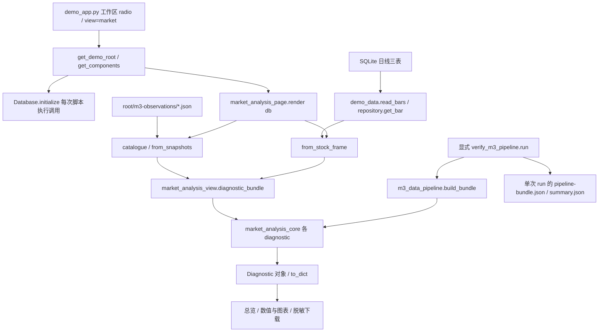

# TASK-M3-READONLY-TRACE-001：M3 调用链、七表与结果持久化审计

审计日期：2026-10-21（Asia/Shanghai）。**结论：当前 M3 页面诊断是运行时计算结果，没有自动写入七张 SQLite 表或完整结果仓储。另有显式数据管线脚本保存完整 JSON，但页面、M4、M5 和 EC2 同步没有接上该文件出口。** 下文区分源码事实、已有运行证据、推断和 UNKNOWN，不把设计或历史测试当本轮执行。

## 1. 任务配置、基线与只读边界

| 字段 | 实际记录 |
| --- | --- |
| 类型 / 等级 | 只读 trace audit / H；涉及持久化与时间语义的审计建议，**不是** #37/#41 的独立 H 通过结论 |
| 唯一执行配置 | OpenAI / Codex Desktop `gpt-6.1-sol / high`；本会话 turn_context `2026-10-21T14:30:43.682Z` 实际核验；不调用子代理或其他模型 |
| 预算 / 重试 | 90 分钟执行预算；同项最多两次不同依据的诊断；费用 UNKNOWN。仅只读证据与新增报告，不实施建议 |
| 仓库 / 审计 main | `fengjnah/a-share-quant-v1`；GitHub API 确认 `c4b682d12c7c8dc42f75e717b855238f635ce05b`，tree `df7280c74a3468b41e1ca08c3e1d7bb87bca2a92` |
| 原工作区 | `F:/codex-agnes/AI-trade`，`codex/m3-remodel-002` / `964a24007ab208d7b10e254a4e86548007c69c4f`，tracked 干净，仅原 `.worktrees/`；2 条 stash、其他 worktree 保留，不切换或清理 |
| 审计工作区 | 新建 `F:/codex-agnes/AI-trade-readonly-trace-001`，分支 `codex/m3-readonly-trace-001`，从精确 main 开始；64 个 tracked src/scripts/deploy 文件逐一与 Git 对象匹配 |
| 相关 PR | #39 head `964a2400…`、merge `90dfec64…`；#40 head `88088b0c…`、merge `26554612…`；#43 head `1be04e75…`、merge=审计 main，均 merged。#44 `79266f15…`、#45 `5ed318f0…` 未合并，不能当作 main 内文件 |
| 规则与冲突 | 实读根 AGENTS、MODEL_ROUTING_POLICY v1.0、TASK_TEMPLATE、PROJECT_STATUS、DECISIONS、DATA/INTERFACE/M3_CORE_CONTRACT、M3 页面任务、数据管线报告/交接、数据库 Schema、AWS 报告及源码/测试。无 src/scripts/docs 下级 AGENTS/override。适用 G01—G12；用户禁止建库/写库优先于 G11 常规全套测试要求，本轮不运行 pytest、应用或初始化 CLI |
| 调研适用性 | 现有实现与证据追踪，不采用新库/来源/算法，不启动外部开源采用调研；后续字段建议只是待审契约草案 |
| 允许的写入 | 仅本报告及 `TASK-M3-READONLY-TRACE-001.evidence.json`，Git 独立分支与 Draft PR；不修改业务/测试/Schema/迁移/配置，不设置环境变量，不连接 SQLite，不采集、不操作服务/AWS/Nginx/代理/TLS |

机器证据：[静态清单](TASK-M3-READONLY-TRACE-001.evidence.json) 含 Git blob、源码摘要、函数行号、七表全部字面引用、动态帮助函数的上下文、结果出口检索点及现有测试定义。字面引用数量不是 SQL 次数或运行覆盖；判断以实际调用方和下面的 SQL 语义为准。所有源码链接固定到审计 SHA，而非浮动 main。

## 2. 从页面入口到核心的实际链路

**入口事实：** [S01] `demo_app.py` 的 sidebar 注册 M1、M2、M3、M4、项目进度；`view=market` 默认选择 M3，分派至 `market_analysis_page.render(db)`。不存在独立 M3 Controller/Service 类；`market_analysis_view` 是本地适配层，`market_analysis_core` 是纯计算/诊断层。项目进度在建库前分流，其他业务页先调用 `get_components()`。

**刷新事实：** `get_components()` 每次构造 Database 并 `initialize()`，后者可建目录、开写连接、BEGIN IMMEDIATE、校验/应用迁移并写迁移账本；即使已有版本无新迁移，也不是 mode=ro 连接。[S02] 因此 `AI_TRADE_READ_ONLY=1` 只禁用采集按钮，不保证应用启动/刷新零数据库写操作。本审计没有为了观察而执行这些入口。

**数据位置：** `root=db.config.path.parent`。指数/宽度/CFFEX 调用 [S03] `catalogue→market_analysis_data.snapshots`，只扫描该 root 的 `m3-observations/*.json`；最多1000个、单文件2MB、文件名须匹配内容SHA256。指数先按 kind/symbol 选文件，核心再截 analysis_date；宽度/CFFEX目录按文件声明日期≤分析日过滤，核心仍检查实际输入时点。文件按日期/观察时间排序只是列表顺序；多个指数/CFFEX版本不默认取最新，宽度多版本须选择，重复日交核心拒绝。[S04]

**股票分支：** `render` 请求 `[分析日−800日, 分析日]`，`demo_data.read_bars` 先发现三表里的明确 instrument/date 键，再逐条 `SQLiteMarketDataRepository.get_bar(...mode='strict_backtest')`。注意这次 Repository 读取模式固定为 strict_backtest，不随页面后续 core mode 改变。DailyBar/投影没有 observed_at，`from_stock_frame` 不推造，核心将缺必需列判 INVALID_DATA/BLOCKED；SQLite 中有合法个股行情不等于当前 M3 个股诊断可算。[S05][S06][T04][T06]

还有一处静态命名差异：页面核心Request直接使用输入框的`symbol.strip()`（默认600000），而`make_request`会规范为600000.SH，数据库投影也保留带交易所代码。当前先被observed_at缺列阻断；即使未来补齐该列，仍须检验Request与记录身份一致性，不能假设原默认输入已贯通。现有helper测试不等于对此页面组合路径的运行复现；本轮不改实现，只记录待后续接线回归。[S04][S05]

**重新计算：** M3 没有 cache_data/cache_resource 装饰器，也不把 diagnostics 放进 session_state；每次 Streamlit 脚本重跑都读文件/股票数据并重新调用核心。`price_diagnostics` 内计算 wave 和价格代理，`fear_greed_diagnostic` 又调用 fear_greed 并在内部再次诊断 breadth，不能称“一次渲染只计算一次每个公式”。as_of 用 `archive.now()` 的当前UTC时点；刷新会改变 request/as_of 和可能改变 snapshot hash，不等于输入文件版本发生修订。[S04][S07][S08]

### 2.1 指标数据流矩阵

下列“当前状态”指源码可达性/已有输入限制，不是本轮重新运行的诊断输出。公共价格基础字段：trade_date、symbol、source、OHLC、observed_at；研究准入另需 event_time/available_at/ingested_at、accepted质量、固定不复权口径、来源/授权/时间收据及独立日历。未知认证不因样本数足够而变成通过。

| 指标 | 页面入口 | 计算函数 / 实际算法 | 输入来源 | 数据库表/文件 | 当前持久化状态 | 缺失条件 / 结论 / 测试 |
| --- | --- | --- | --- | --- | --- | --- |
| 指数日线/均线 | render 指数→diagnostic_bundle | core.price_diagnostics→market_analysis.wave_scenarios；MA20/MA60，C>MA20>MA60偏多、反向偏空、其余中性；方向最低60条 | 显式选定指数文件；collector客户端最多保留550条已结束日期 | root/m3-observations/hash.json；不查日线表 | 原始输入文件已具备保存入口；均线/方向只在内存，CLI可另存bundle | MISSING INPUT→SOURCE_UNAVAILABLE/BLOCKED；少于60→HISTORY_INSUFFICIENT；旧真实输入只有L1证据。[S03][S07][S09][T01][T03] |
| 周线结构 | 同上，独立模块 | price_diagnostics自行按W-SUN聚合OHLC，排除当前周；首周未由传入日历证明完整则排除。≥20个已结束周后，末周close>近20周均值偏多，否则偏空 | 与日线相同；真实完整性还需CalendarEvidence | 同一输入文件；非新周线表 | 计算得到weeks/direction，无自动落库 | 样本不足/日历未知不获L2；不能把已聚合周当认证完整周。[S07][T01] |
| 波浪/反转候选 | wave模块 | price_diagnostics→wave_scenarios；左右各3条严格极值，右3条已出现才确认；日线方向门槛60；多候选、简化推动/ABC及斐波那契 | OHLC历史与7条确认输入的实际时点 | 同指数文件，或股票日线读取 | pivots/scenarios/fibonacci在values；页面只显示最近30个转折，不写结果仓储 | first_usable_at缺任一必要时点即null；不是唯一浪型或经过验证预测。[S07][S09][T01] |
| 全A市场宽度 | render多选宽度→breadth_diagnostic | 报告五种家数；核对eligible=涨+跌+平+suspended+unavailable+missing；覆盖分子=有报价+明确停牌 | 乐咕当前聚合文件；正式范围需逐日历史池证据 | root/m3-observations/hash.json；没有对应正式表 | 原始五计数可保存；派生覆盖只在内存/显式CLI文件 | 缺五计数→FACTOR_MISSING；缺历史池/分区/认证→UNIVERSE_UNKNOWN，不能以涨跌平总数替全A分母。[S08][S03][T01] |
| 全A成交额/因子 | fear_greed模块 | fear_greed_diagnostic丢弃价格amount_cny，只在all_a_scope_verified后将同日market_amount_cny映射到价格日期；旧fear_greed计算当日额/此前20日均额的历史分位 | 必须真实全A market_amount_cny；个股daily_bar_versions.amount不是替代 | 正式全A输入仓储/来源 **NOT IMPLEMENTED**；现有乐咕collector不提供此字段 | 通用核心已有算法；真实输入/自动持久化均缺 | MISSING INPUT，完整分数null；零分母UNKNOWN；非法/缺失标量已有列时INVALID_DATA。[S08][S09][T01][T07] |
| 完整六因子恐贪 | fear_greed模块 | core.fear_greed_diagnostic→market_analysis.fear_greed/past_percentile；趋势25%、动量20%、低波动20%、上涨占比20%、涨停占比10%、全A额5% | 指数价+同日已认证全A宽度/额；最早第41条具备三价格因子 | 两类本地文件；不查完整恐贪结果表 | score/percentile/factors等只在Diagnostic.values；无自动结果表 | 任一因子缺失score=null、不重分权重；非INDEX不给完整市场分数；当前没有完整真实输入。[S08][S09][T01][T07] |
| 独立价格代理 | price_proxy模块 | price_diagnostics→fear_greed；前三因子除0.65；分位用此前最多252条，至少20个、排除当前 | 同一单源/标的/选定版本的价格 | 同指数文件/股票三表 | 内存historical_scores；与完整恐贪独立 | 41条门槛；不能当完整分数或综合情绪票。[S07][S09][T01][T03] |
| CFFEX会员持仓 | render解析选定原始CSV→diagnostic_bundle | 核心cffex_diagnostic具备select_visible_version/net_positions_at/member_position；净仓=同合约同会员scope多−空，净变化=两侧公布变动差 | 页面只解析CSV给元数据，**没有传cffex_records，默认空tuple**；正式record/calendar/scope/publication接线NOT IMPLEMENTED | raw_csv_hex与payload摘要在观察JSON；七表无CFFEX正式排名表 | CSV输入有文件保存；核心净仓结果无页面存储/无正式Repository | 目前页必走SOURCE_UNAVAILABLE/BLOCKED，任何原始CSV成功都不自动生成净仓方向；缺侧为null、真0不等于缺失。[S04][S10][T01][T03] |
| 综合环境/准入 | environment模块 | environment_diagnostic组合wave/fear_greed/cffex_position三类；先逐项L2/L3、同日/as_of/规则，非期货须同指数；保留冲突，再判断完整性；齐全≥2票偏多/偏空→偏强/偏弱，否则震荡 | 上述Diagnostic对象，不从库取“市场环境记录” | 无正式结果表；组件snapshot引用在内存 | 运行时结论、组件血缘；显式CLI可另存 | 缺合格组件→EVIDENCE_MISSING/BLOCKED；冲突→EVIDENCE_CONFLICT；非法组件传播清空。无概率、无订单。[S11][T01][T03] |

`past_percentile`：用当前值与此前60条位置内的同因子有效值比较，至少20个，平值计半秩；不会越过该位置窗口去补更早的有效值。完整/代理总分分位另用252位置窗口。成交额因子因此不只是“存在20条额就完整可算”。这些是现有公式，不是本审计新建议。[S09]

### 2.2 默认值、缺失与准入形成

- 默认分析日硬编码2026-10-16，最大为上海“今天−1日”，不会因当前日历自动选最后交易日。默认沪深300、research、期货IF、会员scope代客，未选择合约/会员时UNKNOWN；空DataFrame、None/NaN及无文件占位不是模拟行情。[S04]
- `_prepare` 要求真实observed_at；仅保留trade_date≤分析日、全部已知时点≤as_of的数据；拒绝身份/重复日/坏质量/OHLC/数字类型和时序矛盾。source/version证据hash不是来源认证。`_coverage` 无已认证日历时分母、比例均UNKNOWN，不从行数猜分母。[S12]
- `_finish`：INVALID_DATA清空values、calculated=false；research只有可见观察且无非法数据可至L1；calculated且无L2阻断原因才L2。严格/纸面模式不满足研究门槛则清空并BLOCKED。主状态优先序为 INVALID_DATA→SOURCE_UNAVAILABLE→NOT_VISIBLE对应BLOCKED→STALE→HISTORY_INSUFFICIENT→FACTOR_MISSING→EVIDENCE_CONFLICT→TIME_UNCERTIFIED，其余为RESEARCH_ALLOWED/BLOCKED/OBSERVATION_ONLY；主状态不等于唯一原因。[S12]
- 当前页面构造的SourceEvidence收据默认UNKNOWN，render未加载calendar/universe_receipt/CFFEX认证记录；因此即便补文件，当前常规页面路径也不能自行获得真实L2。环境内部生成的派生收据不认证其组件。[S04][S11]
- Diagnostic.to_dict输出JSON null、snapshot hash与allowed_uses；它不是save函数。strategy_admission只是独立审批凭据一致性检查，页面未调用；live_trading恒false。[S13]
- M3独立缓存 **NOT IMPLEMENTED**；session_state只保存采集成功/失败文案及控件选择，不保存完整诊断。页面按钮显式触发collect_public/collect_cffex才联网并保存输入，刷新不自动重试；不能把输入归档混称为结果落库。[S04][S03]

## 3. 七张核心表：定义、SQL与消费者

### 3.1 Schema 与迁移入口

[S14] 迁移账本 `LEDGER_SQL` 在迁移注册表之外引导创建；MIGRATIONS只有 v1 `daily_bar_foundation` 和 v2 `security_master_and_calendar`。v1创建instruments/ingestion_runs/daily_bars/daily_bar_versions，v2调用 `reference_statements` 创建security_versions/calendar_versions。没有M3诊断结果/全A宽度/全A额/CFFEX正式结果迁移。[S15]

入口是 `Database.initialize`，调用者为 storage CLI `main→DatabaseConfig.from_env→initialize`、demo_app.get_components、HealthService的_ScratchWriter，以及现有测试；初始化不是构造Database对象时自动发生，而是这些入口显式调用。initialize通过sqlite_master辨识、账本version排序、注册连续性/checksum/超前版本校验，在一个BEGIN IMMEDIATE事务应用缺少迁移。运行模块会写库，故本轮仅阅读。[S02][S16][T02]

### 3.2 七表使用矩阵

下表穷尽的是审计树src/scripts/deploy的实际入口；测试中的直写/故意破坏另列T02/T05。动态 `insert_row` / `write_batch` 不是额外隐藏仓储，已按其唯一两个调用方展开；完整字面引用位置见JSON附件。

| 表名 | Schema 位置 / 键与关联 | 读取入口与查询 | 写入入口 / 更新 | 主要消费者 | 是否被 M3 使用 | 证据 |
| --- | --- | --- | --- | --- | --- | --- |
| schema_migrations | schema.py:LEDGER_SQL；version PK，name/checksum/applied_at；不承载行情或结果 | Database.initialize SELECT * ORDER BY version；部署inventory通用按表计数 | initialize逐迁移INSERT；没有业务UPDATE入口；账本引导不是Migration(0) | 所有数据库入口的结构生命周期 | 业务页分派前间接校验/可能迁移；不是指标输入 | [S02][S14][S21]；T02初始化/重复/回滚/checksum/版本间隙 |
| instruments | v1 _IDENTITY；instrument_id PK，UNIQUE(id,symbol)，symbol九位SH/SZ/BJ格式 | 日线writer查id→symbol；get_bar与read_bars join；M2 coverage/pool；M4 local_coverage；master查锚点 | SQLiteMarketDataRepository.write_many、SQLiteSecurityMaster._insert插入/冲突拒绝；v1触发器禁UPDATE/DELETE | M0入库，M1/M2/M3股票，M4本地发现/主数据 | 仅股票条件分支间接join；指数/宽度/CFFEX不用 | [S06][S05][S17][S18][S19]；T04/T05/T06 |
| ingestion_runs | v1 _IDENTITY；run_id PK，recorded_at；其他三种版本run_id FK引用 | 日线write_many及reference.write_batch检测run重复；get_bar从v.run_id派生血缘，不join此表 | 两个批次writer事务INSERT；无业务UPDATE，禁UPDATE/DELETE | M0批次审计/约束；股票及参考版本的血缘 | 不读取run表内容；仅版本行run_id间接血缘；不是M3计算run表 | [S06][S20]；T04重复run/回滚、T05共享run唯一 |
| daily_bars | v1 _IDENTITY；bar_id PK，UNIQUE(instrument_id,trade_date,adjustment_method)，FK instruments | get_bar按id/日/口径join版本；read_bars按symbol/日期范围/口径/源发现keys，ORDER BY trade_date；M2 coverage/pool、M4范围发现 | write_many INSERT…ON CONFLICT DO NOTHING后SELECT bar_id；旧逻辑对象不更新，禁UPDATE/DELETE | M0/M1/M2/M3股票/M4 | 股票分支有SQL读取链；不代表全部页面领域均消费 | [S06][S05][S18][S19]；T04键/复权/实体隔离、T06 |
| daily_bar_versions | v1 _VERSIONS；version_id PK，FK bar_id/run_id；UNIQUE(bar_id,source,source_version)、UNIQUE(bar_id,source,supersedes_version)，复合自FK，单root/单后继；OHLCV/amount/三时间/quality/factor_version | get_bar按明确id/日/口径/源和available_at、ingested_at≤as_of，ORDER BY max(两时间) DESC LIMIT1；严格模式选中隔离版本后拒绝，不回退旧accepted。read_bars发现keys本身未做可见性过滤，逐key严格读失败会使整次读取失败；M4 local_coverage另加event_time≤as_of | write_many验证每条后INSERT新版本；修订须可见性严格前进，禁覆盖/分叉/UPDATE/DELETE；SQL检查OHLC、非负量额、时间、复权因子 | M0写入；M1/M2/M3股票/M4 | 可读OHLC、量额/版本/run字段；**本模型无observed_at**，M3不自动补齐，也不能把amount当全A额 | [S06][S14][S05][S19]；T04修订/双时点/隔离/原子性、T06 |
| security_versions | v2 reference_schema.reference_statements；version_id PK，FK(id,symbol)→instruments、run_id→runs；UNIQUE(id,record_version)、UNIQUE(id,supersedes_version)+自FK；只A_SHARE，整段periods_json、四时间/来源/证据/生命周期 | SQLiteSecurityMaster.get按id、双时点≤asof、max时间DESC LIMIT1后校验valid_on；resolve先按symbol双时点、row_number PARTITION BY id取可见版本，再上市/退市半开区间，歧义拒绝 | write_many→write_batch→_insert→insert_row；整条时间线追加；禁UPDATE/DELETE，名字间隙/代码复用/版本链受验证和触发器保护 | 参考数据端口；M4 load_batch.resolve历史名称/身份；M1/M2股票价本身不调用master | **当前M3未调用**；不因表存在就视为历史身份/ST已消费。risk_status仍未知 | [S17][S15][S19]；T05生命周期/改名/版本/代码复用/未知ST |
| calendar_versions | v2 reference_schema；version_id PK，UNIQUE(exchange,session_date,record_version)、UNIQUE(exchange,session_date,supersedes_version)+自FK、run_id FK；仅SH/SZ/BJ，accepted开/休或source_error/NULL | SQLiteTradingCalendar.get_day按交易所/日/双时点取max时间DESC LIMIT1；trading_days分区日期取最新，最终ORDER BY session_date；previous_known_trading_day调用范围查询后取最后可用日。缺失/源错误与已知休市分开 | write_many→write_batch→_insert→insert_row；不可变追加、时点前进、禁UPDATE/DELETE；没有当前行情源自动填充实现 | 参考端口及测试；未发现src业务页/管线实际实例化SQLiteTradingCalendar | **M3不读此表**；UI calendar=None，不能用此表的SH日历替代CFFEX开盘日历 | [S22][S15][S07]；T05开休缺错/范围/历史版本/交易所隔离 |

M2 SQL细节：[S18] `analysis_page.render` 的coverage只按source分组symbol，列min/max日期/count distinct，无as_of过滤；pool发现SELECT DISTINCT symbol按代码排序并限制数量。其展示分析数据仍经read_bars严格端口；不能把coverage摘要称历史可见完整覆盖。

M4 SQL细节：[S19] `local_coverage` 显式source、不复权、available/ingested/event≤asof，按symbol聚合、排序、最多MAX_SYMBOLS+1=21个发现行；日期倒序。`load_batch` 用420个日历日、最多20只，逐股read_bars→trading_analysis.analyze→evaluate，并尝试master.resolve；不是全市场池/历史ST认证。

### 3.3 五种状态必须分开

这里的真实行数均来自已有证据E01/E02，**非本轮SELECT**，未证明当前未变。E01五个重点股票库的security/calendar均0；E02云端除账本外均0。没有证据证明这些表不存在于其他未知库或从未有真实记录。

| 表 | 已定义 | 被代码引用 | 有正式写入实现 | 已有真实数据/结构证据 | M3已实际消费的证据 |
| --- | --- | --- | --- | --- | --- |
| schema_migrations | 是 | 是 | 是 | E01重点库/E02云端各2行账本 | 共享启动会调用；本轮不运行，不能冒称当前会话读过 |
| instruments | 是 | 是 | 是 | E01当前8524库1个股票锚点；E02云端0 | 代码支持M3股票join；当前UI实际读取行为UNKNOWN |
| ingestion_runs | 是 | 是 | 是 | E01当前8524库1真实采集批次；E02云端0 | 只有版本血缘关联，非M3读取run表证据 |
| daily_bars | 是 | 是 | 是 | E01当前8524库1217个日期对象；E02云端0 | 有股票读取代码，未证明8524本次会话曾选择/消费；不等于指数输入 |
| daily_bar_versions | 是 | 是 | 是 | E01当前8524库1217个版本；另187/2291/2行独立样本；E02云端0 | 同上；页面旧550条指数验收是文件消费，不是此表消费 |
| security_versions | 是 | 是 | 是 | 现有重点库真实行0；合成测试覆盖不等于真实来源记录 | 无M3接线/真实消费证据 |
| calendar_versions | 是 | 是 | 是 | 同上 | 无M3接线/真实消费证据 |

### 3.4 M0—M5 依赖矩阵

M0指数据访问/采集底座而非单独路由；M1行情、M2交易分析、M3市场分析、M4每日候选是实际UI。M5正式回测/持仓页 **NOT IMPLEMENTED**，项目进度页不是M5。I=初始化生命周期，R/W=相应分支有读/写代码，FK=血缘/约束依赖，—=未接入，N/I=模块未实现。[S01][S19][E02]

| 表 | M0 | M1 | M2 | M3 | M4 | M5 |
| --- | --- | --- | --- | --- | --- | --- |
| schema_migrations | I | I | I | I | I | N/I |
| instruments | W/锚点查验 | R；显式采集间接W | R；显式采集间接W | 股票R；指数无 | R | N/I |
| ingestion_runs | W/重复查验 | 采集W/FK | 采集W/FK | 股票版本run_id血缘，非直接读表 | 版本/主数据血缘 | N/I |
| daily_bars | W/R | R；采集W | R；采集W | 仅股票R | R | N/I |
| daily_bar_versions | W/R | R；采集W | R；采集W | 仅股票R | R | N/I |
| security_versions | 有独立RW端口，未接真实自动采集 | — | — | — | R(resolve) | N/I |
| calendar_versions | 有独立RW端口，未接真实自动采集 | — | — | — | — | N/I |

“已定义却未使用”应准确表述：七表均有生产源码引用和写入口；后两表不是空壳DDL，但没有M3端口接线、已验收真实填充或认证。禁止据此建议删除。

## 4. 诊断结果持久化出口审计（重点）

### 4.1 出口矩阵

| 结果类型 | 生成位置 / 触发 | 保存出口 | 保存字段与时间/版本 | 历史追溯能力 | 当前结论 |
| --- | --- | --- | --- | --- | --- |
| 页面完整Diagnostic | render→diagnostic_bundle→核心，每次重跑 | Python对象，随后st.metric/dataframe/chart/json | request分析日/as_of、实际截止、来源/版本/血缘、times、coverage、values、状态/原因、规则/Schema/hash；**无独立generated_at、持久analysis_run_id** | 同一调用可追元数据；无保存/按日期查询接口 | **运行时计算，不是已保存分析快照**。[S04][S13] |
| 页面脱敏下载 | _details→evidence_payload→download_button，用户下载 | JSON bytes交浏览器；服务端没有Path写入 | 保留诊断元数据、source四项、时间认证/local_read；**去掉values，也没保留calculated和完整source认证收据**；无统一生成时间/批次字段 | 用户可能自行保留文件；服务端无catalogue/历史恢复；缺values无法还原完整Diagnostic/hash输入 | 下载接口已实现，不等于正式仓储；本轮没有下载/生成此文件。[S04][S23][T04] |
| 采集反馈/控件 | _collect、Streamlit控件 | session_state中的成功/失败文案及选择 | 文案数据日/观察时刻或异常类型；不是完整诊断对象 | 内存会话状态，刷新/跨会话不作持久保证 | 不属于M3分析结果存储。[S04] |
| M3缓存 | 页面/核心检索 | 没有cache装饰器/结果模块级缓存 | 仅静态定义/规则；data模块_HTTP_TRACE是worker请求元数据 | 无 | **NOT IMPLEMENTED**；M4自己的cache_data不消费M3。[S03][S19] |
| 指数/宽度/CFFEX原始观察 | 用户显式按钮→collect_public/collect_cffex→save_snapshot | root/m3-observations/内容hash.json，临时文件replace；同内容不覆盖 | kind/source/symbol/trade_date、实际observed、调用方实际ingested、available=null；prices/breadth/raw_csv_hex；CFFEXpayload hash；公共源http_trace | 保留多观察，按kind/symbol/日期读；不等于认证版本仓储/正式结果 | **输入持久化已实现**，不是保存Diagnostic。采集当前READ_ONLY时禁用。[S03][T03] |
| 数据管线完整结果 | scripts.verify_m3_pipeline.run显式执行→build_bundle | 每个独立run目录pipeline-bundle.json；write_json以open('x')创建 | 外层schema_version/run_id/**硬编码历史baseline_sha**/core_contract/calculation版本/core_review/request/requirements；diagnostics完整to_dict含values及实际截止。无独立generated_at；as_of为组包时钟；源batch需配套observation/result证据 | 独占run目录不覆盖，可手工读旧JSON；无正式Repository/目录查询/可信收据或历史API | **实现了文件结果出口，且E03证明历史执行过；不是页面自动结果保存**。[S24][S25][T07] |
| 管线脱敏汇总 | run→public_summary | 同run summary.json，仓库提交的脱敏摘要另由任务维护 | 去全部values/原始帧；保留状态/时点/覆盖/快照引用、run/源传输结果与次数 | 可追某次验收，不足以恢复数值；手工汇编文件不是业务输出消费链 | 有真实历史证据；页面未读取，不能冒充同schema完整对象。[S24][S25][E03] |
| 原始源/HTTP/股票验收 | 显式verify worker、DailyHistoryIngestor | observation.json、result.json、http-events.jsonl、EvidenceStore request/response/result；股票ScratchWriter写隔离health.sqlite3 | 源调用/观察/验证时间、请求/批次、响应摘要/适配记录等；SQLite只存股票事实版本，不含M3分析 | 每run/source证据可追；HTTP元数据不是原始业务结果快照 | 是输入与验收证据，不是M3结果表；失败可能只有文件、无run表行。[S25][S26][S27] |
| SQLite诊断/研究结果表 | 所有迁移、Repository、INSERT/UPDATE检索 | 无正式出口 | 七表无Diagnostic/analysis_date/规则版本联合结果模型 | 无 | **NOT IMPLEMENTED**，不能从data_snapshot_id字段名推断已存。[S14][S15][S06] |
| artifacts任务证据/临时库 | 历史脚本/任务明确输出，不是core自动行为 | 忽略目录JSON、日志、截图、临时/隔离SQLite | 类型混合；必须按具体run/证据逐项解释 | 文件存在/任务记录能证明当时保存，不证明当前页面绑定 | E01/E03/E04为已有证据。本轮不运行历史脚本、不开库。[E01][E03][E04] |
| M4下游 | daily_candidates_data.load_batch | 无M3结果读取 | 每批new MarketState(analysis_date)默认数据不足/validated=false；自身读股票价/主数据 | M4会话缓存自己的批次，无M3 snapshot导入/适配 | **M3→M4 未接通**；market_state文档写“共享”不等于实际接线。[S19][S28][T08] |
| M5下游 | 无实际页/引擎/结果仓储入口 | 无 | 无 | 无 | **NOT IMPLEMENTED**，项目进度不替代回测。[S01][E02] |
| EC2代码发布 | deploy/update-workbench.sh，操作者显式运行 | Git archive→release、current symlink、重启现有服务，保留独立DATA_DIR | 发布SHA及代码/依赖；清单只读统计DB/输入文件 | 有代码发布/回滚准备；不是M3结果版本发布 | **存在代码部署，但无PC结果/SQLite/m3-observations自动同步**；本轮不执行。[S21][E02] |

### 4.2 查到与没查到的区别

1. `Diagnostic.data_snapshot_id` 是对request/source/times/coverage/clean(values)/规则版本的摘要，未保存其输入实体；包含as_of，不能直接当“同日同市场事实唯一键”。`to_dict`、JSON Schema校验和st.json都没有文件/SQL副作用。[S13]
2. 页面诊断本身没有 result.save / Repository.write / INSERT / write_json 回调。唯一下载出口主动剔除values，用户取得它也不是得到完整分析结果。没有观察到服务器保存下载文件的实现。[S04][S23]
3. `build_bundle` 自身纯计算、不I/O；**调用它的验证脚本run**负责写JSON。这一事实由代码和E03旧批次共同支持，不能笼统说“所有M3结果都未保存”，也不能反过来说页面已接管线。[S24][S25]
   本轮另以只读JSON解析确认旧路径 `AI-trade-m3-data-pipeline-001/artifacts/m3-data-pipeline-001/live/pipeline-20261020T153923Z-c55591fd/pipeline-bundle.json` 确实存在：记录其run/schema/request、各诊断状态、values键存在性及文件SHA256于证据附件，没有输出原始价格或重新生成诊断。这证明的是旧脚本文件出口，不能证明页面调用了它。
4. `baseline_sha` 和core_review在管线模块中是静态旧值，不能用该字段证明当前执行代码SHA。后续真正结果存储必须记录实际实施SHA/输入版本清单，不能复制这个历史常量充当执行认证。[S24]
5. M4 `MarketState` 的默认值是明确的阻断占位，不是模拟市场结果；allows要求validated、同日、可见时点和允许状态。当前load_batch没有把M3环境Diagnostic映射进去。[S19][S28]

## 5. 数据库与文件绑定矩阵

**本轮没有查询任何数据库、进程内存、健康端点或云端。** 以下运行状态全部标记来源、时点、提交；“当前”无新证据部分保留UNKNOWN。E01来自未合并PR45的既有只读诊断文件，已经实际读取并固定其blob；不因此声称文件在main，也不将其历史读库行为算作本轮执行。

| 对象 | 路径及关系 | 已有证据/时点 | 本轮结论与边界 |
| --- | --- | --- | --- |
| Windows正式持久研究库 | **UNKNOWN / NOT_CONFIRMED** | E01，2026-10-21 07:54–07:59北京时间；用户未把某Temp路径指定正式持久库 | 不以目录名/有真实行情判正式归属；可能别处或之后变化，本轮不测 |
| 8524 Streamlit配置 | `C:/Users/iyoyi/AppData/Local/Temp/a-share-quant-demo-5gu28e3m/demo.sqlite3`；进程当时cwd `F:/codex-agnes/AI-trade/.worktrees/local-demo-verify` / `1be04e75…`；DEMO_ROOT已设，WORKBENCH_ROOT与QUANT_DB_*未设，READ_ONLY=1 | E01 PID1952/父29704、进程自己的参数/白名单环境→源码绑定；test/DELETE；1217条600000.SH、不复权、2021-10-08～2026-10-15 | **证据时点已确认临时绑定，审计时刻当前绑定UNKNOWN**；不是本轮重看进程/UI或确认生产库；源文件与审计main相关入口一致不证明内存模块一致 |
| 8524 M3文件输入 | 上述Temp根/m3-observations | E01当时0 JSON；与187行Demo、旧M3验收/核心目录的550条文件分离 | 因文件只扫绑定root，其他目录已有指数不会自动显示。当前会话选股/指数实际读取UNKNOWN |
| 其他临时Demo | `%TEMP%/a-share-quant-demo-m2-q_hbvuaj/demo.sqlite3` 187行；`…/a-share-quant-demo-tduod91y/demo.sqlite3` 2291行；旧`task008-real-72un4ppq/real.sqlite3`2行 | E01分别不同批次/标的/日期；均临时样本，不是互为正式备份 | 与8524/云端不混用，本轮不打开、不复制 |
| 默认Demo回退 | 未配WORKBENCH_ROOT且无DEMO_ROOT时，mkdtemp前缀a-share-quant-demo-并由session_state保存根；已配DEMO_ROOT须是已有Temp目录/已有demo.sqlite3 | 源码get_demo_root、existing_demo_root [S01][S05] | 设计路径而非本轮新建实际库；浏览器新会话可能得到不同根，不能用应用通用文件名推断绑定 |
| storage CLI路径 | DatabaseConfig.from_env用QUANT_DB_PATH/ENV/JOURNAL；local默认当前cwd/data/sqlite/local.sqlite3；test/production要求显式路径 | [S02][S16]；Demo入口不走from_env | 此默认不证明文件存在/被使用，也不能控制已运行Demo；本轮不改环境或执行CLI |
| M3管线隔离库 | `F:/codex-agnes/AI-trade-m3-data-pipeline-001/artifacts/m3-data-pipeline-001/live/pipeline-20261020T153923Z-c55591fd/tencent_stock/health.sqlite3` | E01/E03：10-14～15，2条600000.SH；run/source隔离/test/DELETE，非正式实体认证 | 只证明旧数据验收写读；page不会扫描该根，更不查询此库的M3结果表 |
| 健康CLI临时库 | HealthService创建Temp/a-share-health-*/health.sqlite3；_ScratchWriter惰性initialize后写通过映射的批次 | [S26] 源码，无本轮运行 | `--audit-root`文件结果目录不等于正式目标数据库；不能借health成功认定正式入库 |
| artifacts历史观察 | 原工作区artifacts/m3-core-001、管线各source/run、旧Temp页面验收root等 | E03：旧新浪550行截止10-19；E04：旧页面550行截止10-16。旧源授权/日历/历史时间未认证 | 是历史保存观察；仅当明确选择的运行root含对应m3-observations文件，页面才会读。不能推断当前8524已消费它们 |
| AWS EC2展示库 | `/var/lib/a-share-quant-workbench/workbench.sqlite3`；现有Streamlit服务配置WORKBENCH_ROOT，独立于release；Nginx反代实际应用 | E02，2026-10-21约07:24北京时间；运行SHA `6ff4331d…`，7表账本2行其余0；没有上传Demo/行情；代码模板 [S29] 与该证据互相支持 | 已有部署证据支持当时绑定与空库；**当前云端行数/状态UNKNOWN**，本轮无连接/SQL。Windows→EC2数据同步NOT IMPLEMENTED |

E01只说明已扫范围正式路径未确认，不证明全电脑不存在正式库。E02的数据库目录/备份/权限属于其当时运维证据；本报告不重新认证备份、HTTPS或AWS配置，不访问私有凭据/认证文件。

## 6. 事实、推断、未知与阻塞项

| 分类 | 可复核结论 | 依据与停止边界 |
| --- | --- | --- |
| 确认事实 | 七表均有DDL和写实现；M3页无结果SQL写出口；管线显式JSON结果出口存在；当前页未消费它；M4未接M3；M5无实际页 | 上述调用与全树检索，不依赖报告猜实现 |
| 确认事实 | 当前页面不加载认证收据/日历/全A池；CFFEX传空正式records；股票投影缺observed_at | 所以增添SQLite行情本身不足以解锁这些域；不放宽门禁 |
| 有依据推断 | 七表不足支撑完整M3真实原始输入/结果仓储/可复算发布；需要最小增量契约 | 是基于字段/键/调用缺口的设计输入，不是已实施架构决策 |
| UNKNOWN | 审计此刻8524/正式Windows/EC2实际绑定与行数；未知目录数据库；当前浏览器session_state | 本轮只准读已确认旧证据，不启动应用或自行探数据库 |
| BLOCKED / MISSING INPUT | 全A成交额/历史股票池/日历认证、CFFEX正式版本、历史证券ST/停牌/退市及真实来源许可 | 算法或端口已实现不等于存在真实输入；现有证券risk_status未知 |
| NOT IMPLEMENTED | 页面完整诊断自动持久化、M3→M4输入桥、M5、PC→EC2分析快照同步/发布协议 | 不以设计交接图或脚本名称当实现 |
| 审查门禁 | #37/#41仍open且既有记录未有独立H通过，已合并不代替；本审计不担任这些独立审查 | 后续实施/认证需独立任务、冻结SHA与真实证据 |

## 7. 最小后续方案（仅建议，不创建表/任务或实施）

### 7.1 七表是否足够

对已有A股日线的身份锚点、不可变原始版本、批次、日级参考数据，七表提供了可复用底座；对**完整M3输入与输出并不够**。instruments仅有股票式代码/锚点，security_versions限定A_SHARE，没有正式指数身份/单位契约；不能为方便把指数硬塞股票身份。缺全A聚合、逐日股票池/分区、CFFEX完整排名与开盘日历、正式认证引用及诊断结果模型。daily_bar_versions也缺实际observed_at；需设计追加元数据/新版本兼容方式，不能更改已发布迁移或以ingested_at倒填。[S14][S15][S06]

### 7.2 拟议字段契约与版本策略

以下逻辑实体**尚未成为表或批准设计**。后续先冻结contract/schema、主键/FK、时间语义、来源授权与迁移方案，再独立H审查后实施；不预定把所有东西塞入一张JSON表。

| 逻辑实体 | 最少字段/关联 | 主键/版本与时间语义草案 | 数据来源与兼容前置 |
| --- | --- | --- | --- |
| 源观察/采集运行清单 | run_id、源/adapter版本、请求范围、kind/标的/单位、传输/解析/质量结果、原始payload hash/受控引用、真实observed/ingested、event/available及依据、授权状态 | run/观察不可变ID；失败与空结果单独保存，不能当休市；跨源不自动选优 | 复用EvidenceStore与ingestion_runs关联；当前runs仅2字段，扩展用新追加模型/迁移，不改旧账本。公开/研究/存储/再分发许可分别核验 |
| 指数历史版本 | 正式index_id、业务日、OHLC/单位/不复权定义、source_version、quality、四时间、原始观察/run引用 | 单指数/日/源/版本键、显式supersedes；按available且ingested≤as_of选可见版 | 新浪已有受限样本，缺首发/价格口径/质量/日历认证；不得批量回填历史可得时点 |
| 全A逐日池及聚合 | universe_id/date/version、历史身份成员/停牌分区、五计数、eligible/suspended/unavailable/missing、market_amount_cny、单位/覆盖分母、来源/四时间/质量/run | 日期+池定义+源版本；认证池与聚合FK/不可变manifest关联；修订保存旧版 | 新真实历史来源和条款待确认；停牌不等于平盘，缺失不等于0；个股/指数额不能代替全A额 |
| CFFEX完整版本及日历 | exchange/variety/date/version、每合约/会员/scope/side/rank/已知标志/持仓与成交分开、publication、四时间、calendar refs、来源/质量/run | 版本头+行键(contract,member,scope,side,rank)须先定冲突规则；单根完整版本链；保留缺侧null/真0 | 复用CffexRankingsRecord/select_visible_version/net_positions_at；SQLite SH/SZ/BJ日历不含CFFEX开收盘；available_at沿既有后续开盘规则，不擅改为发布时刻 |
| 诊断分析运行/快照 | analysis_run_id、analysis_date、as_of、generated_at、indicator/symbol/scope/mode、实际implementation_sha、Schema/规则版本、输入清单与各行版本/run/payload refs、data_latest_date、times、coverage/分母/refs、missing/reasons、values、calculated/status/admission/allowed_uses、认证/审查引用 | run ID区分尝试；输入/规则/request的内容hash可查重但不能抹去不同as_of；每次结果不可变，重试/修订另版。snapshot_id不能单独充当原始数据仓储 | 复用Diagnostic.to_dict而非页面脱敏payload；显式保存后返回落地ID/摘要；历史按分析日+asof+规则+输入manifest查询，不能默认取最新未知版本 |
| 发布制品manifest | publication_id、analysis_run/snapshot ID、生成/批准/发布时间、发布SHA/Schema/规则、数据截止/过期条件、可分发字段白名单、文件hash、许可/审查证据 | 不可变制品+显式current指针；验证后原子切换、失败保持上一版并标过期；不覆盖正在使用SQLite | 先确认是否发布静态JSON/HTML或供受保护应用读取；现有EC2是动态Streamlit，不假称已有静态发布链；不包含秘密/未经授权原始行情 |

迁移兼容：v1/v2及checksum保持不变；只经新迁移追加。新旧读取端明确Schema版本与未知语义，保留旧read_bars/历史版本路径；新observed_at无证据不能回填，旧记录继续L1/BLOCKED。迁移前需用户确认正式库绑定、备份/只读预检、失败回滚与不丢旧数据证据；由后续任务实施，不在本任务开库演练。

### 7.3 可复用端口与实施顺序

1. **正式绑定/保护任务**：先确认Windows正式持久目录及M0写端/M3读端共用关系，逐项核对E01后续变化；生产建库任务与本只读任务分开。验收是路径/所有权/迁移/备份恢复和禁止误写Temp/云端，不是改个环境变量即完成。
2. **输入契约与仓储设计H任务**：冻结上述指数/全A/CFFEX/观察元数据契约及新迁移兼容。复用Database事务、SQLiteMarketDataRepository、参考write_batch、EvidenceStore和CFFEX版本端口；不要复用data_snapshot_id名称冒充存储服务。需要事务回滚/重复/修订/跨源/时点/零未知/分区/发布边界反例和独立H。
3. **来源验收任务**：有明确授权、固定端点/日期/次数、TLS正常后分别取得真实输入；传输成功、映射、保存读回、覆盖/授权/时间认证分列。补源不能通过UI降低门槛。
4. **结果存储与页面/下游接线任务**：核心保持唯一计算/准入；调用方显式save完整snapshot后展示落地ID；统一两种适配器契约，接入正式输入与认证证据；M4需要明确Diagnostic→MarketState适配和来源/日期/规则检查，缺项仍关闭。M5引擎另立任务，不能只加路由。
5. **PC→EC2发布任务**：在来源分发许可和独立审查具备后，只发布允许的派生诊断/必要解释/完整性manifest；UNKNOWN/BLOCKED可如实显示，不能叫策略准入。EC2若只展示可读制品，无需携带原始行情；若要在云端复算，必须保留可用的精确原始输入版本、批次、参考快照及规则/代码，不能只拿脱敏summary或截图。验证传输摘要/Schema、权限/过期、重复幂等、原子切换/失败回退；不直接复制覆盖在线SQLite。

以上为依赖顺序建议，没有自动创建这些任务、添加表、调用来源或部署。

## 8. 本轮验证、已读测试与交付边界

| 检查 | 本轮实际方式 / 结果 |
| --- | --- |
| 源码基线 | GitHub main/ref/commit/相关PR只读API；Git status/stash/worktree；64个src/scripts/deploy文件逐一与审计Git对象匹配 |
| 静态检索 | rg定位七表/SQLite语句/Repository/保存出口/缓存/下游/部署；stdlib ast.parse读取函数、导入、测试定义，不import ai_trade、不调用方法。详见证据JSON |
| 表引用 | 字面行：schema_migrations4、instruments14、ingestion_runs8、daily_bars14、daily_bar_versions16、security_versions11、calendar_versions6；含Schema/帮助函数/查询，不能解释为真实SQL执行次数 |
| 历史证据 | 实读E01/E02/E03/E04；E01固定到未合并PR45提交，记录其时点与局限；没有重新测进程/数据库或沿用旧报告推断源码 |
| 自动化测试 | **NOT RUN**。既有测试源码检查见下表，不能写成本轮passed；pytest会初始化SQLite，与用户明确边界冲突 |
| 实网/应用/样本外/生产 | **NOT RUN**；无行情、无Streamlit启动/刷新、无DB连接/初始化、无AWS/配置操作。GitHub源码/API与官方CI跳过文档读取不是行情请求 |
| 本轮文档验证 | PASS：41个固定源码/证据引用、37个行号锚点、JSON解析及AST/文本一致性断言；64个源码文件与基线匹配。Git diff检查exit0；仅新增两份审计文件，不借旧测试数量充数 |

现有测试只作覆盖证据（没有重新执行）：

| ID | 路径与实际断言范围 |
| --- | --- |
| T01 | tests/unit/test_market_analysis_core.py：daily_exact_minimum、weekly_closed_minimum_ohlc、partial_first_week、missing_calendar_session、right_confirmation_and_prefix_replay、breadth_denominator_partition、full_six_factors、any_missing_market_factor、percentile_excludes_current、cffex_requires_publication_scope_and_calendar、environment_conflict_missing_and_snapshot_mismatch、l3_needs_sha_data_and_independent_execution_review_receipt |
| T02 | tests/unit/test_db.py：初始化账本/重复初始化、事务/中断回滚、外键、DDL+账本失败原子性、checksum/未来版本/历史缺口、append-only；tests/unit/test_reference_data.py:v1_upgrade_preserves_daily_data_and_released_checksum、v2_failure_rolls_back_tables_and_ledger |
| T03 | tests/manual/test_m3_page_offline.py：空/失败/只读/导航，原始CFFEX不绕过核心；test_m3_diagnostic_states.py：八类实际Streamlit渲染、阻断残留值隐藏；只是现有离线测试，不是真实来源认证 |
| T04 | tests/unit/test_market_analysis_view.py：正式核心映射、未知分母、身份/时间保留、重复版本拒绝、股票不推造observed_at、下载元数据脱敏及不含raw values |
| T05 | tests/unit/test_reference_data.py：master改名/半开生命周期/代码复用/双时间/缺ST、calendar开休缺错/范围/修订/交易所隔离/批次回滚/SQL约束/共用run；不是已取得真实历史主数据或日历 |
| T06 | tests/unit/test_market_data_repository.py：原子批次/重复run与版本/修订/双截止/不同源与复权/实体隔离/隔离新版本不回退；test_demo_data.py：源/请求过滤、空读不建run、未来/隔离拒绝、只打开已有Temp根 |
| T07 | tests/unit/test_m3_data_pipeline.py：空源分开、传输PASS不发Receipt、旧观察不补时点、原始CFFEX不转正式版、public_summary剔除输入/数值、default_run不创建client/worker、输出限制artifacts；default_run测试本身会写JSON，故本轮也未执行 |
| T08 | tests/unit/test_daily_candidates.py：未知/未来/错日MarketState不放行、缺历史名称/身份不产正式候选；M4自身缓存/会话行为不证明M3结果已存 |

### 8.1 证据索引

下列源链接均固定审计SHA；对应函数完整起止、全部原文引用点和测试函数行号见机器附件。

[S01]: https://github.com/fengjnah/a-share-quant-v1/blob/c4b682d12c7c8dc42f75e717b855238f635ce05b/src/ai_trade/demo_app.py#L14
[S02]: https://github.com/fengjnah/a-share-quant-v1/blob/c4b682d12c7c8dc42f75e717b855238f635ce05b/src/ai_trade/storage/db.py#L56
[S03]: https://github.com/fengjnah/a-share-quant-v1/blob/c4b682d12c7c8dc42f75e717b855238f635ce05b/src/ai_trade/market_analysis_data.py#L32
[S04]: https://github.com/fengjnah/a-share-quant-v1/blob/c4b682d12c7c8dc42f75e717b855238f635ce05b/src/ai_trade/market_analysis_page.py#L140
[S05]: https://github.com/fengjnah/a-share-quant-v1/blob/c4b682d12c7c8dc42f75e717b855238f635ce05b/src/ai_trade/demo_data.py#L48
[S06]: https://github.com/fengjnah/a-share-quant-v1/blob/c4b682d12c7c8dc42f75e717b855238f635ce05b/src/ai_trade/data_access/repository.py#L33
[S07]: https://github.com/fengjnah/a-share-quant-v1/blob/c4b682d12c7c8dc42f75e717b855238f635ce05b/src/ai_trade/market_analysis_core.py#L244
[S08]: https://github.com/fengjnah/a-share-quant-v1/blob/c4b682d12c7c8dc42f75e717b855238f635ce05b/src/ai_trade/market_analysis_core.py#L301
[S09]: https://github.com/fengjnah/a-share-quant-v1/blob/c4b682d12c7c8dc42f75e717b855238f635ce05b/src/ai_trade/market_analysis.py#L88
[S10]: https://github.com/fengjnah/a-share-quant-v1/blob/c4b682d12c7c8dc42f75e717b855238f635ce05b/src/ai_trade/market_analysis_core.py#L402
[S11]: https://github.com/fengjnah/a-share-quant-v1/blob/c4b682d12c7c8dc42f75e717b855238f635ce05b/src/ai_trade/market_analysis_core.py#L467
[S12]: https://github.com/fengjnah/a-share-quant-v1/blob/c4b682d12c7c8dc42f75e717b855238f635ce05b/src/ai_trade/market_analysis_core.py#L82
[S13]: https://github.com/fengjnah/a-share-quant-v1/blob/c4b682d12c7c8dc42f75e717b855238f635ce05b/src/ai_trade/market_analysis_contract.py#L181
[S14]: https://github.com/fengjnah/a-share-quant-v1/blob/c4b682d12c7c8dc42f75e717b855238f635ce05b/src/ai_trade/storage/schema.py#L25
[S15]: https://github.com/fengjnah/a-share-quant-v1/blob/c4b682d12c7c8dc42f75e717b855238f635ce05b/src/ai_trade/storage/reference_schema.py#L10
[S16]: https://github.com/fengjnah/a-share-quant-v1/blob/c4b682d12c7c8dc42f75e717b855238f635ce05b/src/ai_trade/storage/__main__.py#L8
[S17]: https://github.com/fengjnah/a-share-quant-v1/blob/c4b682d12c7c8dc42f75e717b855238f635ce05b/src/ai_trade/security_master/repository.py#L28
[S18]: https://github.com/fengjnah/a-share-quant-v1/blob/c4b682d12c7c8dc42f75e717b855238f635ce05b/src/ai_trade/analysis_page.py#L71
[S19]: https://github.com/fengjnah/a-share-quant-v1/blob/c4b682d12c7c8dc42f75e717b855238f635ce05b/src/ai_trade/daily_candidates_data.py#L16
[S20]: https://github.com/fengjnah/a-share-quant-v1/blob/c4b682d12c7c8dc42f75e717b855238f635ce05b/src/ai_trade/reference_data/repository_support.py#L19
[S21]: https://github.com/fengjnah/a-share-quant-v1/blob/c4b682d12c7c8dc42f75e717b855238f635ce05b/deploy/update-workbench.sh#L45
[S22]: https://github.com/fengjnah/a-share-quant-v1/blob/c4b682d12c7c8dc42f75e717b855238f635ce05b/src/ai_trade/trading_calendar/repository.py#L36
[S23]: https://github.com/fengjnah/a-share-quant-v1/blob/c4b682d12c7c8dc42f75e717b855238f635ce05b/src/ai_trade/market_analysis_view.py#L216
[S24]: https://github.com/fengjnah/a-share-quant-v1/blob/c4b682d12c7c8dc42f75e717b855238f635ce05b/src/ai_trade/m3_data_pipeline.py#L127
[S25]: https://github.com/fengjnah/a-share-quant-v1/blob/c4b682d12c7c8dc42f75e717b855238f635ce05b/scripts/verify_m3_pipeline.py#L212
[S26]: https://github.com/fengjnah/a-share-quant-v1/blob/c4b682d12c7c8dc42f75e717b855238f635ce05b/src/ai_trade/market_data/health_service.py#L66
[S27]: https://github.com/fengjnah/a-share-quant-v1/blob/c4b682d12c7c8dc42f75e717b855238f635ce05b/src/ai_trade/market_data/ingestor.py#L47
[S28]: https://github.com/fengjnah/a-share-quant-v1/blob/c4b682d12c7c8dc42f75e717b855238f635ce05b/src/ai_trade/market_state.py#L15
[S29]: https://github.com/fengjnah/a-share-quant-v1/blob/c4b682d12c7c8dc42f75e717b855238f635ce05b/deploy/workbench.service.example#L7
[T01]: https://github.com/fengjnah/a-share-quant-v1/blob/c4b682d12c7c8dc42f75e717b855238f635ce05b/tests/unit/test_market_analysis_core.py#L68
[T02]: https://github.com/fengjnah/a-share-quant-v1/blob/c4b682d12c7c8dc42f75e717b855238f635ce05b/tests/unit/test_db.py#L15
[T03]: https://github.com/fengjnah/a-share-quant-v1/blob/c4b682d12c7c8dc42f75e717b855238f635ce05b/tests/manual/test_m3_page_offline.py#L8
[T04]: https://github.com/fengjnah/a-share-quant-v1/blob/c4b682d12c7c8dc42f75e717b855238f635ce05b/tests/unit/test_market_analysis_view.py#L24
[T05]: https://github.com/fengjnah/a-share-quant-v1/blob/c4b682d12c7c8dc42f75e717b855238f635ce05b/tests/unit/test_reference_data.py#L75
[T06]: https://github.com/fengjnah/a-share-quant-v1/blob/c4b682d12c7c8dc42f75e717b855238f635ce05b/tests/unit/test_market_data_repository.py#L26
[T07]: https://github.com/fengjnah/a-share-quant-v1/blob/c4b682d12c7c8dc42f75e717b855238f635ce05b/tests/unit/test_m3_data_pipeline.py#L41
[T08]: https://github.com/fengjnah/a-share-quant-v1/blob/c4b682d12c7c8dc42f75e717b855238f635ce05b/tests/unit/test_daily_candidates.py#L37
[E01]: https://github.com/fengjnah/a-share-quant-v1/blob/5ed318f023194c6f0f9767168957f7b3a1b56fb5/docs/M0_DB_PATH_CONFIRM_REPORT.md
[E02]: https://github.com/fengjnah/a-share-quant-v1/blob/c4b682d12c7c8dc42f75e717b855238f635ce05b/docs/tasks/TASK-AWS-DEPLOY-M0-M5-001.md
[E03]: https://github.com/fengjnah/a-share-quant-v1/blob/c4b682d12c7c8dc42f75e717b855238f635ce05b/docs/M3_DATA_PIPELINE_REPORT.md
[E04]: https://github.com/fengjnah/a-share-quant-v1/blob/c4b682d12c7c8dc42f75e717b855238f635ce05b/docs/tasks/TASK-M3-REMODEL-002.md

| 运行证据ID | 实读文件 / 固定版本 | 仅覆盖的证据类型 |
| --- | --- | --- |
| E01 | [PR45路径报告](https://github.com/fengjnah/a-share-quant-v1/blob/5ed318f023194c6f0f9767168957f7b3a1b56fb5/docs/M0_DB_PATH_CONFIRM_REPORT.md)及同提交docs/evidence/TASK_M0_DB_PATH_CONFIRM_001.json；本机对应AI-trade-m0-db-path-confirm-001工作区 | 当时只读进程/路径/五库计数与边界；未合并、不代表本轮新观察 |
| E02 | [AWS部署记录](https://github.com/fengjnah/a-share-quant-v1/blob/c4b682d12c7c8dc42f75e717b855238f635ce05b/docs/tasks/TASK-AWS-DEPLOY-M0-M5-001.md)、docs/operations/AWS_RESOURCE_INVENTORY.md | 当时EC2路径、运行SHA、空库、代码部署；不是本轮联网/云端查询 |
| E03 | [数据管线报告](https://github.com/fengjnah/a-share-quant-v1/blob/c4b682d12c7c8dc42f75e717b855238f635ce05b/docs/M3_DATA_PIPELINE_REPORT.md)、交接/认证矩阵、docs/evidence/TASK_M3_DATA_PIPELINE_001.json | 旧run受限请求/隔离写读/文件结果；真实认证仍BLOCKED |
| E04 | [页面任务](https://github.com/fengjnah/a-share-quant-v1/blob/c4b682d12c7c8dc42f75e717b855238f635ce05b/docs/tasks/TASK-M3-REMODEL-002.md)、docs/M3_PAGE_DIAGNOSTICS.md、docs/evidence/M3_REMODEL_002_20261020.json | 旧页面/离线/E2E证据，不冒充本轮执行 |

### 8.2 验收与交付

本审计完成主要入口→指标→输出追踪，七表分别给出定义/真实入口/SQL/键/消费者/测试及五种状态，四张要求矩阵与模块依赖均已列出。数据库/服务当前态未确认处明确UNKNOWN，建议尚未实施。实现与配置无修改，未连接或初始化任何数据库。

仅用 Draft PR 交付报告和必要静态证据；提交附 `[skip ci]`，因为现有工作流会执行创建SQLite的pytest，遵守本任务“任何数据库禁写”而非伪称CI通过。GitHub对push/pull_request支持该标记，可能留下待检查状态；不解除任何合并要求，详见[官方说明](https://docs.github.com/en/actions/how-tos/manage-workflow-runs/skip-workflow-runs)。不改变工作流、分支保护或权限，不自动合并/部署。

审计结果作为后续独立H设计/正式数据库任务输入；本报告本身拟安排独立复核 `TASK-M3-READONLY-TRACE-002-REVIEW`，配置待指派，不能由本会话换角色出独立通过。现有核心/页面H门禁保持。最终提交/PR在Draft PR正文绑定，避免在提交内递归填写自身SHA。
